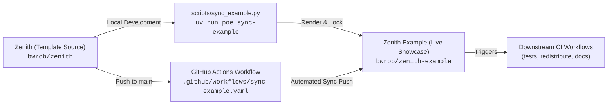

# Zenith Showcase Synchronization & Status Monitoring (`workflow-example-sync`)

This skill documents the relationship between **`zenith`** and **`zenith-example`**.
It covers synchronization mechanics and the mandatory verification protocol
for downstream test status after pushing changes to `zenith:main`.

---

## 1. Architectural Relationship



- **`zenith` (`bwrob/zenith`)**: The single source of truth. Contains the Cookiecutter template
  specifications (`{{cookiecutter.project_slug}}/`), lifecycle hooks (`hooks/`), shared partials,
  agent skills, and template regression tests.
- **`zenith-example` (`bwrob/zenith-example`)**: The live, deployed downstream showcase repository.
  It is a fully instantiated Python library and CLI project rendered directly from `zenith`.
  It serves as:
  1. A live reference for end users and AI coding agents.
  2. A real-world canary test suite verifying that every tool, test, static typing, and workflow succeeds.
  3. The deployment origin for documentation hosted on GitHub Pages.
- **Cardinal Rule**: **Never make ad-hoc edits exclusively inside `zenith-example`.** The
  `sync_example.py` script overwrites manual changes in `zenith-example`. All bug fixes,
  configuration updates, and feature additions must originate in `zenith/{{cookiecutter.project_slug}}` or `zenith/hooks/`.

---

## 2. Local Synchronization Workflow

Before pushing non-trivial template modifications to `zenith`, synchronize and verify
`zenith-example` locally.

### Step 1: Run Local Sync Task

From the `zenith` repository root, execute:

```bash
uv run poe sync-example
```

This automated task (`scripts/sync_example.py`):

1. Instantiates the Zenith template with showcase context variables into an isolated temporary directory.
2. Wipes stale files in `../zenith-example` while preserving the `.git/` history and branches.
3. Copies newly rendered project files into `../zenith-example`.
4. Generates an updated `uv.lock` via `uv lock`.
5. Runs `uv run poe fix` inside `../zenith-example` to format Python (Ruff), TOML (Taplo), Markdown (Rumdl), YAML/CSS (Prettier), and fix typos.

### Step 2: Verify Downstream Quality Gate

Change into the local showcase directory and execute the complete verification suite:

```bash
cd ../zenith-example
uv run poe test             # Enforces 100% test coverage (fail_under = 100)
uv run poe code-quality      # Runs lint, format-check, format-check-toml, type-check, tach, etc.
uv run prek run --all-files
```

Both `poe test` and `poe code-quality` must exit with return code `0` before proceeding.

---

## 3. Automated CI Sync Pipeline (`sync-example.yaml`)

When you push changes to `main` in `bwrob/zenith`:

1. **GitHub Actions Trigger**: `.github/workflows/sync-example.yaml` executes automatically.
2. **Environment Setup**: Configures SSH deploy credentials using the repository secret `EXAMPLE_REPO_DEPLOY_KEY`.
3. **Execution**:

   ```bash
   uv run python scripts/sync_example.py ../zenith-example
   ```

4. **Push**: Commits any detected changes with message `chore(showcase): sync with bwrob/zenith@<commit-sha>`
   and pushes to `bwrob/zenith-example:main`.

---

## 4. Post-Push Verification Protocol (Mandatory)

Whenever you push commits to `zenith:main`, you must track both upstream and
downstream CI runs. Monitor these workflows until all runs pass green.

### Protocol Phase 1: Monitor Upstream Sync Workflow

Verify that the sync workflow in `zenith` successfully executes and pushes to `zenith-example`:

```bash
# List the latest sync workflow runs in zenith
gh run list --repo bwrob/zenith --workflow sync-example.yaml --limit 1

# Watch the active run until completion
gh run watch <run-id> --repo bwrob/zenith
```

Verify that the output reports `✓ sync-showcase in ...s`.

### Protocol Phase 2: Monitor Downstream Showcase CI Runs

Once the sync commit lands on `bwrob/zenith-example:main`, GitHub Actions will trigger multiple
validation workflows in `zenith-example`. List and monitor them:

```bash
# Inspect the active workflow runs triggered on zenith-example
gh run list --repo bwrob/zenith-example --limit 5
```

The downstream workflows to verify are:

1. **`Python Tests & Quality Gates` (`python_tests.yaml`)**:
   - Matrix testing across Python 3.12, 3.13, 3.14, and 3.15.
   - Code coverage measurement (`fail_under = 100`).
   - Static analysis (`pyrefly check`, `complexipy`, `tach check`).
2. **`Package Build & Distribution Smoke Verification` (`test_redistribute.yaml`)**:
   - Wheel and sdist building via uv.
   - Isolated clean installation and test suite execution against the built wheel.
3. **`Documentation Build & Deployment` (`docs.yaml`)**:
   - Zensical strict compilation and deployment to GitHub Pages.
4. **`Dependency Guard` (`guard-dependencies.yaml`)**:
   - Supply-chain security and vulnerability scanning with `uv audit`.

Watch the primary test workflow until completion:

```bash
gh run watch <run-id> --repo bwrob/zenith-example
```

---

## 5. Troubleshooting & Downstream Remediation

If downstream showcase CI fails:

### Step 1: Diagnose Failure Cause

View failed step logs using the GitHub CLI:

```bash
gh run view <run-id> --repo bwrob/zenith-example --log-failed
```

Common root causes:

- **Coverage drops below 100%**: A new code path in `src/` or `_lazy.py` lacks unit tests in `tests/test_core.py`.
- **TOML formatting failure**: A newly introduced or modified `.toml` file does not match `.taplo.toml` formatting.
- **Markdown or syntax issue**: Documentation contains malformed links, unescaped MathJax equations, or unrendered code blocks.
- **Lockfile mismatch**: `uv.lock` in the showcase repository requires dependency resynchronization.
- **Windows-only symlink mismatch**: Local verification passes on macOS or Linux,
  but Windows `sync_skills` runs fail. Cause: `os.path.relpath` emits
  backslash separators on Windows. Symlink verification then compares
  backslash paths against POSIX-style expected targets and mismatches.
  Remedy: normalize with `Path(os.path.relpath(...)).as_posix()` before
  storing or comparing link targets (fixed in `scripts/sync_skills.py`).
  Treat "local green" as insufficient evidence for Windows. Verify the
  Windows job in the sync workflow before declaring a cross-platform
  synthesis complete.

### Step 2: Reproduce Locally

In your local `zenith-example` checkout:

```bash
cd /Users/bwrob/dev/zenith-example
git pull origin main
uv run poe test
uv run poe code-quality
```

### Step 3: Fix at Upstream Source

Return to `zenith` and edit the template source:

```bash
cd /Users/bwrob/dev/zenith
# Edit files under {{cookiecutter.project_slug}}/ or hooks/
uv run poe sync-example
cd ../zenith-example && uv run poe test && uv run poe code-quality
cd ../zenith
git add -A
git commit -m "fix(template): resolve downstream showcase verification failure"
git push origin main
```

Re-execute **Section 4 (Post-Push Verification Protocol)** until all runs report green.

---

## 6. Architectural Invariants

1. **100% Mandatory Test Coverage**: Both `zenith` and `zenith-example` mandate 100% statement and branch coverage (`fail_under = 100`).
2. **Strict TOML Alignment**: All TOML configuration files must pass `uv run poe format-check-toml` (`taplo format --check`).
3. **Zero Direct Showcase Edits**: Never commit directly to `zenith-example` without matching upstream changes in `zenith`.
