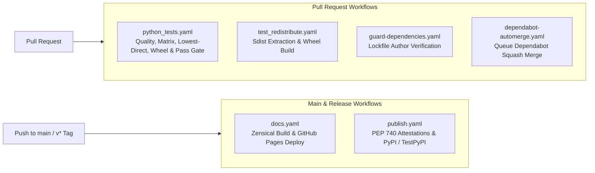

# CI/CD Pipeline

When `include_ci` is enabled, Zenith scaffolds six GitHub Actions workflows into
`.github/workflows/` covering pull request verification, dependency governance,
documentation deployment, and PyPI release publishing.

## Workflow Reference

| Workflow                             | File                        | Triggers                                            | Key Jobs                                                                        | Purpose                                                                                                                                               |
| :----------------------------------- | :-------------------------- | :-------------------------------------------------- | :------------------------------------------------------------------------------ | :---------------------------------------------------------------------------------------------------------------------------------------------------- |
| **Package Tests**                    | `python_tests.yaml`         | `push` (`main`), `pull_request` (`main`)            | `quality`, `test`, `test-lowest`, `test-dist`, `check` (`🛠️ All Checks Status`) | Static analysis, OS × Python test matrix with 100% coverage, lowest-direct resolution, wheel smoke test, and single pass-gate check                   |
| **Source Distribution Verification** | `test_redistribute.yaml`    | `push` (`main`), `pull_request` (`main`)            | `test-sdist` (`📦 Sdist Extraction & Redistribution Smoke Test`)                | Builds `--sdist`, extracts the `.tar.gz` into an isolated directory, runs `poe test`, and verifies wheel build from sdist                             |
| **Guard Dependencies**               | `guard-dependencies.yaml`   | `pull_request_target` (`pyproject.toml`, `uv.lock`) | `guard-dependencies` (`🛡️ Verify Dependency Modification Author`)               | Closes dependency PRs from unauthorized authors; permits only maintainers (`OWNER`, `MEMBER`, `COLLABORATOR`), `dependabot[bot]`, and `renovate[bot]` |
| **Dependabot Auto-Merge**            | `dependabot-automerge.yaml` | `pull_request`                                      | `dependabot` (`🤖 Enable Auto-Merge for Dependabot`)                            | Runs `gh pr merge --auto --squash` on `dependabot[bot]` PRs so they merge once the pass gate succeeds                                                 |
| **Docs**                             | `docs.yaml`                 | `push` (`main`), `workflow_dispatch`                | `deploy` (`🚀 Deploy Documentation to GitHub Pages`)                            | Builds strict Zensical documentation (`zensical build --clean --strict`) and deploys to GitHub Pages via OIDC                                         |
| **Publish to PyPI and TestPyPI**     | `publish.yaml`              | `push` (`v*` tags), `workflow_dispatch`             | `build`, `publish-testpypi`, `publish-pypi`                                     | Builds sdist/wheel, signs PEP 740 Sigstore provenance attestations, and publishes via Trusted Publishing (OIDC)                                       |

## Pull Request Quality & Pass Gate

`python_tests.yaml` runs four parallel verification stages that fan into a single
aggregating job:

1. **`🎨 Code Quality & Static Analysis` (`quality`)**: Runs `ruff` (lint and format),
   `pyrefly` (type check and 100% type coverage), `complexipy` (cognitive complexity),
   `rumdl` (Markdown lint), `typos`, `tach` (module layer boundaries), `zizmor` (GitHub
   Actions security), and `griffe check` (public API breaking-change detection against
   the base branch).
2. **`🐍 Python Tests Matrix` (`test`)**: Executes `uv run poe test` across
   `ubuntu-latest`, `macos-latest`, and `windows-latest` for every supported Python
   version (3.12–3.15). Sets `UV_EXCLUDE_NEWER` to a 1-hour rolling cutoff and fails if
   tests leave modified or untracked files in the working tree.
3. **`🔬 Lowest Direct Dependencies Verification` (`test-lowest`)**: Runs `uv sync
   --group test --resolution lowest-direct` and executes the test suite to verify that
   minimum version bounds in `pyproject.toml` remain compatible.
4. **`📦 Distribution Wheel Verification` (`test-dist`)**: Builds the wheel and imports
   every public module in an isolated environment (`uv run poe test-dist`).
5. **`🛠️ All Checks Status` (`check`)**: Evaluates `re-actors/alls-green` across all
   upstream jobs (`if: always()`) so branch rulesets only need to require a single
   status check instead of every matrix entry.

In parallel, `test_redistribute.yaml` (`📦 Sdist Extraction & Redistribution Smoke
Test`) builds the source distribution (`uv build --sdist`), extracts the `.tar.gz` into
an isolated directory outside the git checkout, runs `uv run poe test`, and builds a
wheel from the extracted sdist.

> [!IMPORTANT]
> **Enable Repository Auto-Merge for the Pass Gate**
>
> When a branch ruleset requires the **`🛠️ All Checks Status`** pass gate before
> merging, `dependabot-automerge.yaml` (`🤖 Enable Auto-Merge for Dependabot`) queues
> Dependabot pull requests via `gh pr merge --auto --squash` while checks are still
> running. In newly created GitHub repositories, you must enable auto-merge:
>
> 1. Navigate to **Settings** → **General** → **Pull Requests** and check **Allow
>    auto-merge** (or run `gh repo edit --enable-auto-merge`).
> 2. Under **Settings** → **Rules** → **Rulesets**, require status checks to pass before
>    merging and select **`🛠️ All Checks Status`**.
>
> Without **Allow auto-merge** enabled, the `🤖 Enable Auto-Merge for Dependabot` job
> fails with `GraphQL: Auto merge is not allowed for this repository
> (enablePullRequestAutoMerge)` whenever a pass gate is active.

## Dependency Governance

- **`guard-dependencies.yaml`**: Triggers on `pull_request_target` whenever a PR
  modifies `pyproject.toml` or `uv.lock`. It inspects only event metadata (never
  checking out untrusted PR code) and verifies that the author is either an allowlisted
  bot (`dependabot[bot]`, `renovate[bot]`) or a repository maintainer (`OWNER`,
  `MEMBER`, `COLLABORATOR`). Unauthorized dependency PRs receive an explanatory comment
  and are closed automatically.
- **`dependabot-automerge.yaml`**: Triggers on `pull_request` for `dependabot[bot]`,
  fetches PR metadata via `dependabot/fetch-metadata`, and arms `gh pr merge --auto
  --squash` so dependency updates merge automatically after **`🛠️ All Checks Status`**
  passes.

## Documentation Deployment

`docs.yaml` runs `uv run zensical build --clean --strict` on every push to `main` (and
via manual `workflow_dispatch`) to validate internal links, anchors, footnotes, and
generated `site/llms.txt` / `site/llms-full.txt` feeds before deploying to GitHub Pages
via OIDC.

> [!IMPORTANT]
> **Configure GitHub Pages Deployment Source**
>
> In newly created GitHub repositories, you must explicitly configure GitHub Pages to
> deploy from Actions:
>
> 1. In your repository on GitHub, navigate to **Settings** → **Pages**.
> 2. Under **Build and deployment** → **Source**, select **GitHub Actions** (not "Deploy
>    from a branch").
>
> Without this setting, the `deploy` job in `docs.yaml` will fail with an authorization
> error when pushing to `main`.

## Trusted Publishing & Provenance

`publish.yaml` builds source and wheel distributions, verifies wheel imports in an
isolated environment, generates cryptographic PEP 740 build provenance attestations via
`actions/attest-build-provenance`, and publishes without long-lived API tokens using
PyPI Trusted Publishing (OpenID Connect):

- **Release tags (`v*`)**: Runs `build` followed by `publish-pypi` using the `pypi`
  GitHub Environment.
- **Manual dispatch (`workflow_dispatch`)**: Runs `build` followed by `publish-testpypi`
  using the `testpypi` GitHub Environment for pre-release verification.

## Template Showcase Synchronization

In the upstream `bwrob/zenith` template repository only, `sync-example.yaml` runs on
every push to `main`, renders the template with canonical showcase settings
(`scripts/sync_example.py`), and pushes any changes to
[`bwrob/zenith-example`](https://github.com/bwrob/zenith-example) so downstream CI
workflows verify the rendered project end to end.
