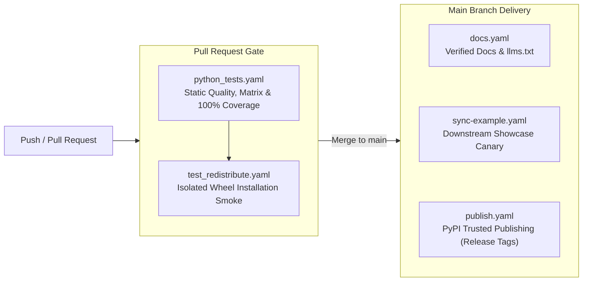
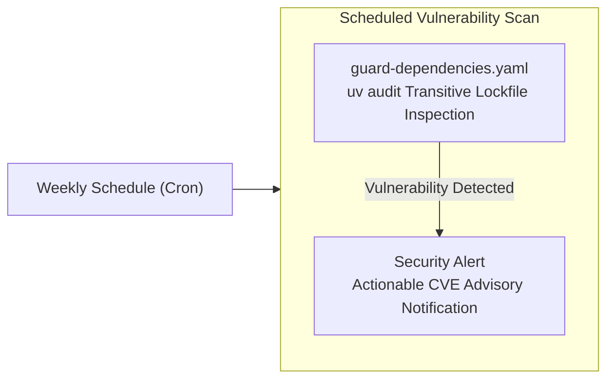

# CI/CD Pipeline

Zenith scaffolds a production-grade automation suite using GitHub Actions. Rather than treating CI as a simple pass/fail script, Zenith organizes automation into two distinct operational lifecycles: a continuous delivery pipeline triggered by developer code changes, and a scheduled governance pipeline running background security audits.

---

## Delivery Pipeline

### `python_tests.yaml`

Guarantees code correctness, strict typing, architectural boundaries, and cross-version compatibility across Python 3.12 through 3.15.

Automated quality gates block syntax flaws, unannotated functions, cyclomatic complexity spikes, circular imports, and undeclared dependencies before human review begins. Mandatory 100% statement and branch coverage enforces complete assertion depth, lowest-direct resolution proves that declared minimum dependency bounds in `pyproject.toml` actually work, and `UV_EXCLUDE_NEWER` establishes an explicit package cutoff timestamp to shield builds against upstream supply-chain disruptions.

---

### `test_redistribute.yaml`

Proves that built wheel (`.whl`) and source (`.tar.gz`) distribution packages install and execute cleanly in isolated user environments.

Tests run inside a developer checkout often pass because uncommitted files or assets exist locally on disk. Installing freshly built wheels into a completely isolated environment and executing the test suite against the installed artifact eliminates "works on my machine" blind spots, guaranteeing that end users installing via `uv add` or `pip install` receive a fully functional distribution.

---

### `docs.yaml`

Builds and deploys verified documentation to GitHub Pages while compiling machine-readable `llms.txt` feeds for AI assistants.

Strict build-time validation eliminates link rot by failing deployments whenever an internal link, API reference anchor, or footnote is broken. The workflow deploys credential-free via GitHub OpenID Connect (OIDC) permissions, while automatically generating plain-text `site/llms.txt` and `site/llms-full.txt` feeds that allow AI coding tools to consume the library's entire API surface.

---

### `sync-example.yaml`

Automatically instantiates the template with canonical context on every push to `main` and synchronizes the rendered project to the live downstream repository (`bwrob/zenith-example`).

Template updates can subtly introduce broken syntax or invalid configurations that isolated unit tests miss. Instantiating and pushing a real repository acts as a continuous integration canary for template health, while providing external developers with a browsable, tested reference implementation.

---

### `publish.yaml`

Publishes signed wheel and source packages to PyPI with cryptographic build provenance attestations whenever a release tag is pushed.

PyPI Trusted Publishing (OpenID Connect) authenticates the release without long-lived API tokens or passwords stored in repository secrets. Cryptographic build provenance attestations generated via GitHub Attestations give consumers mathematical proof that release artifacts were built directly from the verified source commit without tampering.

---

## Scheduled Governance

### `guard-dependencies.yaml`

Continuously audits locked transitive dependencies against published CVE vulnerability databases on a recurring schedule.

Security vulnerabilities are frequently uncovered in third-party packages months after a project is locked and deployed. Running scheduled background audits alerts maintainers to newly disclosed CVEs, ensuring prompt supply-chain remediation before vulnerabilities impact production services.
