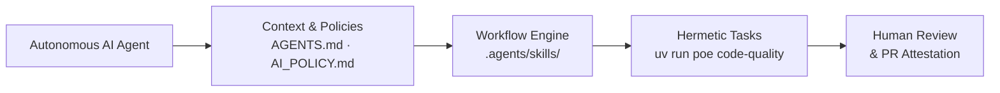
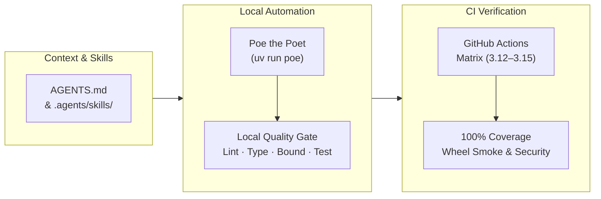
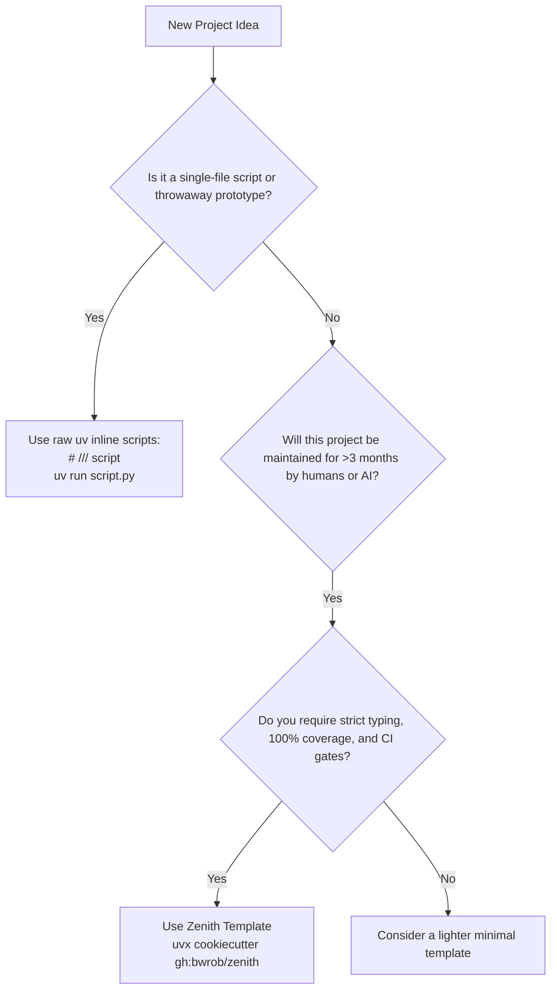

# Zenith Philosophy

Zenith is not a generic template. It is a strict development system for humans
and autonomous AI coding agents. The system builds production software with high
confidence, zero architectural drift, and consistent code quality.

Zenith embodies a practical principle: **automated, strict quality guardrails
accelerate development rather than hindering it.**

## Strict Guardrails Accelerate Development

Conventional engineering wisdom often treats guardrails as overhead—bureaucratic speed
bumps that slow down feature delivery. Teams relax type checkers, postpone test
coverage, skip complexity limits, and permit circular dependencies under the illusion of
moving faster.

Zenith rejects this premise. Strict, automated quality guardrails were not created
merely to constrain AI assistants; they serve human engineers directly. When quality
gates are automated, exhaustive, and non-negotiable, engineering velocity increases
for developers and AI agents alike:

- **Refactoring Is Fearless**: 100% statement and branch test coverage guarantees that
  regressions surface immediately. Human developers and AI agents can restructure
  internal architectures with complete confidence, knowing that broken edge cases fail
  in 2 seconds locally.
- **Cognitive Overhead Drops to Zero**: Automated rules eliminate style debates,
  formatting discussions, and bikeshedding. Code reviews focus exclusively on domain
  logic, data contracts, and system architecture.
- **Ambiguity Disappears**: Strict static types serve as living machine contracts.
  Developers and AI agents never have to guess what shape an object takes or what values
  a function accepts.
- **Rigor Protects the Repository**: Autonomous agents cannot commit untyped objects,
  hallucinated imports, convoluted logic, or fragile workarounds because the gate
  rejects non-compliant code immediately. Human developers receive the exact same safety
  net against late-night typos, subtle logic flaws, and missed edge cases.

### The Business ROI: Defending Rigor to Engineering Leadership

When engineering leaders (CTOs, VPs of Engineering) evaluate strict template standards,
they inevitably weigh the upfront investment against delivery velocity. Here is how
Zenith's guardrails deliver concrete business return:

1. **Shift-Left Mean Time to Detect (MTTD)**: Catching a bug in a local 2-second test
   run costs orders of magnitude less in engineering hours and customer trust than
   triaging a regression in staging or production.
2. **Radically Faster Pull Request Turnaround**: By automating formatting, import
   hygiene, type completeness, and boundary verification, code review turnaround drops
   from days to hours. Reviewers spend zero cognitive energy pointing out style
   inconsistencies, focusing 100% on domain logic and architectural contracts.
3. **Safe AI Acceleration**: Autonomous AI coding assistants can generate 40%+ of
   project boilerplate without degrading repository standards. Mechanical gates
   guarantee that hallucinated imports, unverified logic, and loose types are rejected
   before human review.
4. **The Short-Term Tax vs. The Compounding Dividend**: During the first one or two
   sprints, developers adapting to strict type checking and 100% coverage may notice a
   minor upfront investment while learning mocking and typing patterns. By month two,
   this pays a compounding dividend: teams spend their time delivering features rather
   than debugging legacy regressions.

### The Guardrail Stack

-   **100% Statement & Branch Coverage**

    ---

    Every execution path, error branch, and fallback is verified by automated tests.
    While customizable for early prototypes, complete branch coverage provides the
    foundation for fearless refactoring and reliable AI code generation.

-   **Strict Static Typing & 100% Type Completeness**

    ---

    Strict type checking enforces complete type annotations across all function
    signatures, variables, and module interfaces. Implicit `Any` inference is strictly
    prohibited.

-   **Cognitive Complexity Ceilings**

    ---

    Functions are held to low cognitive and cyclomatic complexity limits. Deeply nested
    loops, cascading conditionals, and convoluted branching logic are blocked directly
    at the authoring gate.

-   **Architectural Boundary Enforcement**

    ---

    Modular layers enforce strict dependency directions. Circular imports and unapproved
    cross-boundary access are strictly prohibited.

-   **Zero-Warning Tolerance**

    ---

    Builds and test suites run with warnings treated as fatal errors. Deprecated APIs,
    unclosed resources, and syntax deprecations fail the build immediately.

-   **Automated Security & Supply-Chain Audits**

    ---

    Transitive dependencies and workflow configurations are audited against known
    vulnerability databases with pinned cutoff dates to prevent supply-chain attacks.

### Pragmatic Rigor: the Testing Spectrum & Prototyping Modes

Quality gates are designed to serve engineers, not paralyze them. While Zenith defaults
to 100% statement and branch coverage to enable fearless refactoring, it fully embraces
practical engineering realities:

- **Sanctioned Platform Exclusions**: Code interfacing directly with operating system
  margins (`sys.platform == 'win32'`), hardware drivers, or defensive assertions can
  be excluded with `# pragma: no cover` without breaking the global gate.
- **The Prototyping Ratchet for MVPs**: When exploring new product concepts or building
  early-stage prototypes where 70% of code may be rewritten next week, teams can adjust
  `fail_under = 80` in `.coveragerc`. As the product architecture stabilizes, ratchet
  the threshold back toward 100% to lock in long-term reliability.
- **Emergency Incident Protocols**: During critical production incidents, engineering
  leads can approve targeted pragma comments or hotfix branch exceptions to restore
  service immediately, with follow-up tasks to backfill coverage once the incident
  resolves.

## Fast Feedback Loops Make Strict Quality Checks Practical

Thorough quality checks historically carried a significant penalty: slow linters,
sluggish type checkers, and long test suites that broke developer flow and triggered
context switching. When running quality checks takes 45 seconds, developers look away,
check messages, and avoid running checks until the end of the day.

This is where modern Rust-native tooling enters the picture. **Speed is not the
philosophy itself; speed is what makes thorough quality checks frictionless.**

By standardizing on fast, Rust-powered tooling, Zenith compresses complete quality
checks into seconds:

- Linting, formatting checks, type checks, and markdown audits complete in under 2
  seconds combined.
- Fast feedback keeps developers and autonomous agents in flow, eliminating the friction
  of strict rules.
- Local pre-commit hooks and live documentation previews run instantaneously.

Strictness provides the safety; sub-second performance provides the velocity.

## AI-Ready Architecture

Autonomous AI coding agents now write and refactor substantial portions of production
codebases.

However, unsupervised AI agents easily produce degraded code:

- Weak type annotations (`Any`, `dict[str, Any]`, unconstrained generics).
- Hallucinated imports or undeclared dependencies.
- Spaghetti logic that passes happy-path tests but fails at scale.
- Subtle degradation of docstrings, comments, and architectural contracts.

Zenith builds an **AI-ready environment** from commit zero:

### Elective AI Tooling & Skills

All AI tooling and agent skills in Zenith are **strictly elective**. Zenith does not
force AI workflows onto teams that prefer pure-human development. During project
scaffolding, two dedicated Cookiecutter prompts configure your preferred level:

- **`include_agent_skills`**: Determines whether to include the 40+ modular engineering
  skills and SDD subagent templates in `.agents/`. When set to `false`, the entire
  `.agents/` directory is omitted.
- **`ai_tools`**: Selects which AI assistant configuration profiles to scaffold:
  - `all`: Scaffolds configuration profiles and context links for all 13 supported AI
    assistants.
  - `recommended`: Scaffolds the most popular mainstream assistants (Claude Code,
    Cursor, OpenAI Codex, OpenCode, Google Gemini, GitHub Copilot).
  - `ide-only` / `cli-only`: Scaffolds targeted configurations matching your preferred
    form factor.
  - Custom list: Supply specific comma-separated tools (for example,
    `claude, cursor, zed`).
  - `minimal`: Scaffolds only canonical `AGENTS.md` and `AI_POLICY.md` without any
    tool-specific dot-directories.
  - `none`: Completely removes all agent configs, instruction files, and context links,
    yielding a clean traditional Python repository.

Regardless of your choice, the underlying Python architecture, hermetic `uv`
environment, testing stack, and strict quality gates remain completely identical.

### Context Discovery

Every Zenith project maintains a canonical `AGENTS.md` in the repository root. This file
establishes operational boundaries, bug-scoping workflows, and zero-drift conventions,
symlinked for universal tool compatibility across editor and CLI environments. For a
complete breakdown of supported configurations and live-testing status across AI coding
tools, consult the
[Agentic Tool Compatibility Matrix](skills/index.md#agentic-tool-compatibility-matrix).

### Modular Agent Skills

Agents do not just need rules—they need structured operational procedures. Zenith
provides a standardized skill library spanning workflows, tool mechanics, and
engineering guides.

### Machine-Readable Documentation

Documentation builds automatically compile plain-text `site/llms.txt` and
`site/llms-full.txt` feeds, allowing AI coding assistants to consume the library's
entire API surface in a clean, high-signal format.

## Architectural Workflow

Zenith connects human developers, autonomous AI agents, local hermetic automation, and
CI quality gates into a unified pipeline:

- **Shared Context**: Humans and AI agents follow the instructions in `AGENTS.md` and
  modular skills in [`.agents/skills/`](skills/index.md) (when AI tooling is enabled).
- **Hermetic Poe Tasks**: Development tasks execute via
  **[Poe the Poet](tools/poethepoet.md)** inside the hermetic project environment
  (`uv run poe <task>`).
- **Strict Quality Gates**: Pull requests enforce 100% test coverage, strict typing,
  complexity ceilings, wheel installation smoke tests, and security audits—safeguarding
  both human developers and autonomous agents against regressions.

For a detailed breakdown of the CI verification pipeline, see
[CI/CD Actions](ci-actions.md).

## Project Sizing & Fit

Zenith is deliberately opinionated: the architecture is engineered for longevity and
maintainability rather than disposable prototypes.

### Recommended Use Cases

- **Production Libraries & SDKs**: Packages published to PyPI requiring semantic
  versioning, strict type hints, and complete test guarantees.
- **Enterprise Services & APIs**: Backend services that evolve over years with multiple
  contributors.
- **CLI Tools**: Ergonomic command-line applications requiring typed option parsing,
  Rich terminal styling, and cross-platform reliability.
- **AI-Native Applications**: Projects where autonomous coding agents perform daily
  development, refactoring, and maintenance.

### Unsuitable Use Cases

- **A 50-line utility script**: Do not use Zenith. Use `uv run script.py` with inline
  PEP 723 metadata.
- **A 24-hour hackathon project**: When rapid experimentation and throwing away 90% of
  the code matters more than clean architecture, Zenith's 100% coverage and complexity
  limits will feel restrictive.
- **Isolated syntax practice**: If you are solely learning Python's basic `for` loop
  syntax for the first time, a full production template is unnecessary overhead.
  (However, if you are a junior engineer building your first production service or
  serious portfolio project, Zenith provides ideal safety nets.)

## Brownfield Adoption & Incremental Migration

Engineering organizations rarely have the luxury of starting 100% of their projects from
greenfield templates. If you are adopting Zenith principles in an existing codebase,
apply this progressive ratcheting strategy:

1. **Step 1: Unify Tooling with uv and Ruff**: Replace legacy package managers with `uv`
   and legacy linters with `ruff check` and `ruff format`. This delivers immediate speed
   improvements without code changes.
2. **Step 2: Ratchet Coverage Progressively**: If your existing service has 65%
   coverage, do not immediately enforce `fail_under = 100`. Set `fail_under = 65` in
   `.coveragerc` and ratchet upward with each milestone, requiring 100% coverage only on
   newly introduced modules.
3. **Step 3: Capture Boundary Baselines with Tach**: Run `tach check --record` to
   capture existing import structures without failing CI, then gradually eliminate
   legacy circular dependencies.
4. **Step 4: Enable Strict Typing in Increments**: Configure Pyrefly with transitional
   settings, migrating key domain models to strict typing before enforcing complete type
   coverage across legacy endpoints.
