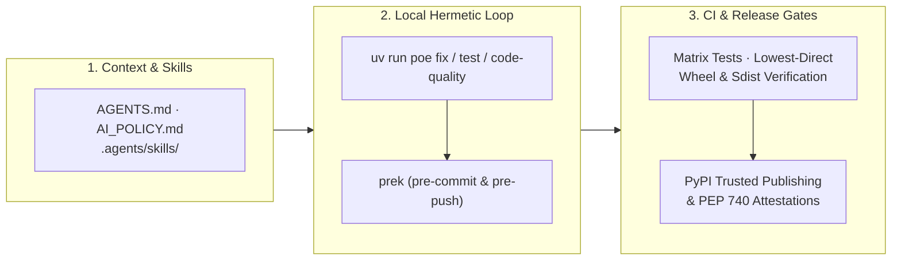
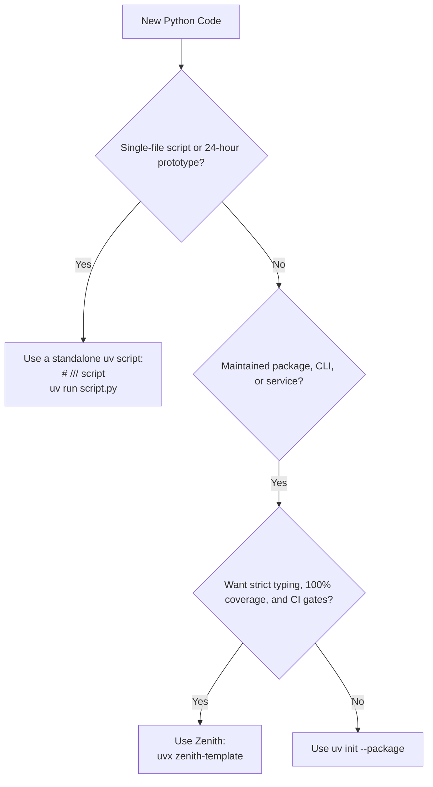

# Zenith Philosophy

Zenith is built around a single engineering premise: **strict, fast, automated quality
gates increase development speed rather than slowing it down.**

Teams often relax type checkers, defer test coverage, skip complexity ceilings, and
tolerate circular imports in the name of moving faster. In practice, loose standards
shift the cost onto code review, manual QA, and production debugging. And when AI coding
agents work in a permissive repository, they quickly introduce `Any` types, untested
error branches, and cross-layer coupling.

## Why Strict Guardrails Increase Velocity

When quality checks are deterministic and run in under two seconds locally, strict rules
remove friction for both human developers and AI coding agents:

- **Fearless refactoring**: 100% statement and branch coverage surfaces broken edge
  cases in seconds, allowing major internal restructuring without silent regressions.
- **Zero-bikeshedding code reviews**: Formatting, import order, type completeness, spell
  checking, and layer boundaries are enforced before a pull request is opened. Reviewers
  focus on domain logic and API design.
- **Types as machine contracts**: Strict static typing with `Any` banned means neither
  humans nor agents have to guess parameter shapes or return types.
- **Mechanical containment for AI agents**: An autonomous agent cannot finish a task
  with hallucinated imports, untyped attributes, or deeply nested spaghetti functions
  because `uv run poe code-quality` and `uv run poe test` reject the diff immediately.

### Guardrail Overview

| Invariant                          | Enforced Threshold                                               | Canonical Tool                                                          |
| :--------------------------------- | :--------------------------------------------------------------- | :---------------------------------------------------------------------- |
| **Test coverage**                  | 100% statement and branch coverage (`fail_under = 100`)          | [Coverage.py](tools/coverage.md) & [pytest](tools/pytest.md)            |
| **Static typing & completeness**   | `preset = "strict"` and 100% type coverage (`--strict`)          | [Pyrefly](tools/pyrefly.md)                                             |
| **Linting & formatting**           | `select = ["ALL"]` with preview rules; no bare `# noqa` comments | [Ruff](tools/ruff.md), [Taplo](tools/taplo.md), [rumdl](tools/rumdl.md) |
| **Cognitive complexity**           | Maximum score of `10` per function or method                     | [complexipy](tools/complexipy.md)                                       |
| **Module & dependency boundaries** | Unidirectional layers (`cli -> core`); zero undeclared imports   | [Tach](tools/tach.md) & [Deptry](tools/deptry.md)                       |
| **Warning & API discipline**       | `filterwarnings = "error"`; breaking API diffs flagged           | [pytest](tools/pytest.md) & [Griffe](tools/griffe.md)                   |
| **Workflow & lockfile security**   | Pedantic GitHub Actions static audit; CVE lockfile checks        | [zizmor](tools/zizmor.md) & [uv](tools/uv.md)                           |

### Pragmatic Escape Hatches

Guardrails exist to serve engineers, not trap them. Zenith includes explicit escape
hatches for real-world trade-offs:

- **Targeted lint and coverage exclusions**: Platform-specific branches
  (`sys.platform == "win32"`) or defensive unreachable branches can use
  `# pragma: no cover` or `# ruff: ignore[rule-name]` with an inline rationale comment.
  Type guards (`if TYPE_CHECKING:`), `Protocol` stubs, `@overload`, and `assert_never`
  are excluded in `.coveragerc` out of the box.
- **Prototyping ratchet**: During early MVP exploration where code churn is high, teams
  can lower `fail_under` in `.coveragerc` (for example, `fail_under = 80`) and ratchet
  it back to `100` once interfaces stabilize.

## Speed Makes Strictness Practical

Strict checks only hurt developer flow when the tools are slow. When a linter and type
checker take 45 seconds, developers stop running them locally and wait for CI to fail.

By standardizing on Rust-native tools (`uv`, `ruff`, `pyrefly`, `tach`, `complexipy`,
`prek`, `rumdl`, `taplo`, `typos`, `zizmor`, `typst`), Zenith runs the entire
`uv run poe code-quality` pipeline in a couple of seconds. Fast local hooks
(`pre-commit` for file-scoped formatters and `pre-push` for whole-project type and
boundary checks) keep commits instantaneous while catching defects before code leaves
your workstation.

## Verification Pipeline

Zenith connects repository context, local hermetic tasks, and CI verification into one
pipeline:

- **Context & Skills (Elective)**: When enabled, root `AGENTS.md`, `AI_POLICY.md`, and
  modular skills in [`.agents/skills/`](skills/index.md) give AI coding assistants
  deterministic rules and tool runbooks. Setting `ai_tools = "none"` and
  `include_agent_skills = false` during generation omits all AI assets for a pure-human
  repository.
- **Local Hermetic Loop**: Every task runs inside the locked `uv` environment via
  **[Poe the Poet](tools/poethepoet.md)** (`uv run poe <task>`) and
  **[prek](tools/prek.md)**.
- **CI & Release Gates**: Pull requests run the same Poe tasks across OS and Python
  matrices, test minimum dependency bounds (`--resolution lowest-direct`), verify wheel
  and sdist archives, and gate merges through a single pass-gate job. See
  **[CI/CD Actions](ci-actions.md)** for full details.

## Project Sizing & When Not to Use Zenith

Zenith is designed for long-lived packages and services, not throwaway scripts:

- **Good fit**: Production libraries and SDKs published to PyPI, typed CLI applications,
  long-lived backend services, and codebases maintained with AI coding agents.
- **Poor fit**:
  - **Single-file scripts**: Use `uv run script.py` with inline PEP 723 script metadata
    instead of a full repository structure.
  - **Throwaway hackathon prototypes**: If 90% of the code will be discarded tomorrow,
    100% branch coverage and complexity ceilings add unnecessary ceremony.

## Brownfield Adoption (Incremental Migration)

When bringing Zenith practices to an existing repository, adopt the guardrails
incrementally rather than all at once:

1. **Migrate packaging and formatting (`uv` + `ruff`)**: Switch to `uv.lock` and
   `ruff format` / `ruff check` first for immediate speed gains without behavioral
   changes.
2. **Baseline test coverage (`.coveragerc`)**: Set `fail_under` to your current coverage
   floor (for example, `fail_under = 65`) so coverage can never regress, then ratchet it
   upward as modules are touched.
3. **Record architectural boundaries (`tach`)**: Define your module layers in
   `tach.toml` and block new circular dependencies before untangling legacy imports.
4. **Ratchet static typing (`pyrefly`)**: Add `project-includes` directory by directory,
   enforcing `pyrefly coverage check` on refactored packages first.
