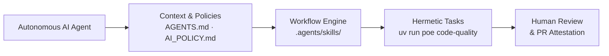
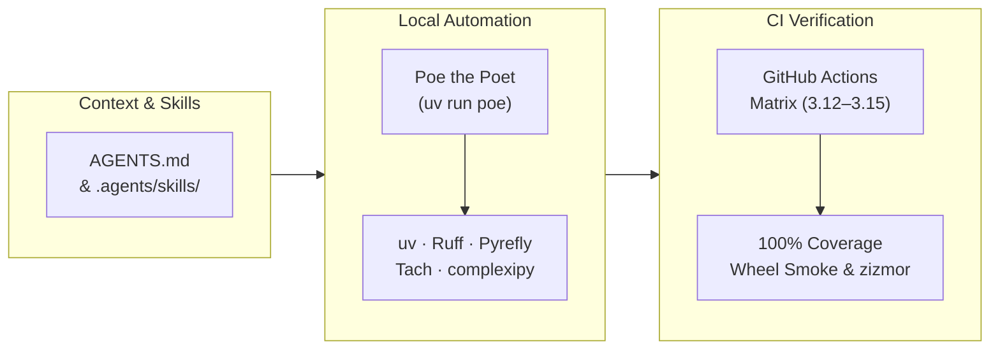
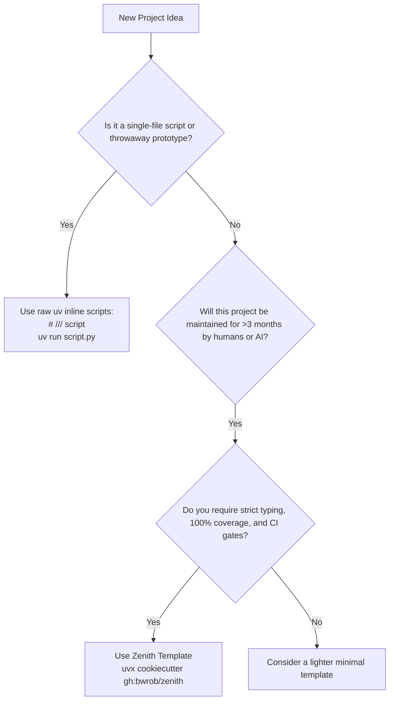

# Zenith Philosophy

Zenith is not a generic template. It is an opinionated, strict development system crafted for teams of humans and autonomous AI agents who want to build production software with high confidence, zero architectural drift, and uncompromising code quality.

---

## Modern Rust-Native Tooling

For over a decade, Python development suffered from fragmented, sluggish tooling:
- Dependency resolution with `pip` and `virtualenv` took minutes.
- Code style required separate tools for formatting (`black`), import sorting (`isort`), style linting (`flake8`), docstring checking (`pydocstyle`), and upgrades (`pyupgrade`).
- Type checkers like legacy `mypy` were slow and often struggled with complex generic inference.
- Markdown linters and documentation generators required separate Node.js or Ruby runtimes.

Zenith eliminates this fragmentation by standardizing on a **modern, unified, Rust-powered toolchain**:

| Domain | Legacy Python Stack | Zenith Modern Toolchain | Performance Difference |
|---|---|---|---|
| **Package Management & Builds** | `pip`, `pip-tools`, `poetry`, `flit` | **[uv](tools/uv.md)** | 10x – 100x faster |
| **Linting & Code Formatting** | `flake8`, `black`, `isort`, `pyupgrade` | **[Ruff](tools/ruff.md)** | 10x – 100x faster |
| **Static Type Checking** | `mypy` (basic) | **[Pyrefly](tools/pyrefly.md)** (strict preset) | Instant AST type analysis |
| **Cognitive Complexity** | `radon`, manual review | **[complexipy](tools/complexipy.md)** | Sub-second cognitive audits |
| **Architectural Boundaries** | `import-linter` | **[Tach](tools/tach.md)** | Rust-native boundary checks |
| **Markdown Validation** | `markdownlint-cli` (Node.js) | **[rumdl](tools/rumdl.md)** | Rust-native embedded code linting |
| **Spell Checking** | `codespell`, manual proofreading | **[typos](tools/typos.md)** | Sub-second binary scanning |
| **Documentation Engine** | `mkdocs`, `sphinx` | **[Zensical](tools/zensical.md)** | Instant live-reloading & MathJax |

### Sub-Second Feedback Loops

The primary cost in software development is context switching. When a linter or test suite takes 45 seconds to run, developers look away, check messages, or lose their train of thought.

By using tools written in Rust and managed through `uv`, Zenith brings feedback loops down to **milliseconds**. Running linting, formatting checks, type checks, and markdown audits takes less than 2 seconds combined.

---

## AI-Ready Engineering

Software engineering has crossed a threshold: autonomous AI coding agents (Claude Code, Google Gemini CLI, Antigravity, OpenAI Codex, Cursor, Windsurf, Aider) now write and refactor substantial portions of production codebases.

However, unsupervised AI agents often generate **"AI slop"**:
- Weak type annotations (`Any`, `dict[str, Any]`, unconstrained generics).
- Hallucinated imports or undeclared dependencies.
- Spaghetti logic that works for the happy path but contains hidden complexity.
- Degradation of docstrings, comments, and architectural contracts.

Zenith is designed from the ground up as an **AI-ready environment**:

### Context Discovery
Every Zenith project maintains a canonical `AGENTS.md` in the repository root. This file establishes:
- Operational instructions (using `uv run <command>`, never touching global Python).
- Reproduction-first bug scoping requirements.
- Zero-drift conventions for Git, branching, and testing.
- Symlinks to `CLAUDE.md`, `.cursorrules`, `.windsurfrules`, and tool configurations for Codex CLI and Aider.

### Modular Agent Skills
Agents do not just need rules; they need operational workflows. Zenith provides a standardized skill library:
- **`workflow-code-review`**: Pre-flight audit against architecture and AI policies before opening PRs.
- **`workflow-adr`**: Structured architectural decision recording using MADR templates.
- **`guide-ste100`**: Simplified Technical English validation so agents produce clear, non-ambiguous documentation and prompts.
- **`workflow-git`**: Conventional commit authoring with AI disclosure checklists.
- **`tool-*`**: Specialized guides instructing agents on exact syntax and best practices for every tool.

### Machine-Readable Documentation
Zensical compiles `site/llms.txt` and `site/llms-full.txt` during every documentation build. AI assistants can consume the entire project API and guide surface in a single, high-signal text feed.

---

## Ruthless Guardrails

Zenith rejects the notion that guardrails slow teams down. On the contrary: **strict guardrails eliminate ambiguity and liberate engineers to move fast without fear**.

When guardrails are automated and strict:
- Code reviews focus on domain logic and system architecture, not trivial syntax, formatting, or missing test cases.
- Refactoring can be executed aggressively because 100% test coverage and boundary checks immediately surface broken contracts.
- AI agents cannot commit half-baked solutions because the quality gate fails immediately.

### The Guardrail Arsenal

-   __100% Statement & Branch Coverage__

    ---

    Coverage.py is configured with `fail_under = 100` and `branch = true`. Every single line of code and conditional branch must be executed and asserted in automated tests.

-   __Strict Static Typing__

    ---

    Meta's Pyrefly static type checker is set to `preset = "strict"`. All parameters, return values, and generic types must be explicitly declared and structurally sound.

-   __Cognitive Complexity Ceiling__

    ---

    `complexipy` limits cognitive complexity to **<= 10** per function or method. Deeply nested loops, cascading conditionals, and convoluted branching logic are blocked at the gate.

-   __Architectural Boundaries__

    ---

    `tach` prevents circular imports and enforces modular layering. Furthermore, `tach check-external` ensures that code only imports third-party libraries explicitly listed in `pyproject.toml`.

-   __Zero-Warning Tolerance__

    ---

    Pytest runs with `filterwarnings = "error"`. Deprecated APIs or unclosed resources fail the build immediately.

-   __Supply-Chain & CI Security__

    ---

    `zizmor` audits GitHub Actions workflows for script injection, excessive token permissions, and vulnerable actions. `UV_EXCLUDE_NEWER` enforces reproducible supply-chain cutoffs.

---

## Architectural Workflow

Zenith connects human developers, autonomous AI agents, local hermetic automation, and CI quality gates into a unified pipeline:

- **Shared Context**: Humans and AI agents follow the instructions in `AGENTS.md` and modular skills in [`.agents/skills/`](skills/index.md).
- **Hermetic Poe Tasks**: Development tasks execute via **[Poe the Poet](tools/poethepoet.md)** inside the hermetic `uv` environment (`uv run poe <task>`).
- **Strict Quality Gates**: Pull requests enforce 100% test coverage, strict typing, complexity <= 10, wheel installation smoke tests, and security audits.

For a detailed breakdown of the CI verification pipeline, see [CI/CD Actions](ci-actions.md).

---

## Project Sizing

Zenith is unapologetically opinionated. It is designed for longevity, not instant disposable scripts.

### Recommended Use Cases
- **Production Libraries & SDKs**: Packages published to PyPI that require semantic versioning, strict type hints, and full test guarantees.
- **Enterprise Services & APIs**: Backend services that will evolve over years with multiple contributors.
- **CLI Tools**: Ergonomic command-line applications requiring typed option parsing, Rich styling, and cross-platform reliability.
- **AI-Native Applications**: Projects where autonomous coding agents perform daily development, refactoring, and maintenance.

### Unsuitable Use Cases
- **A 50-line utility script**: Do not use Zenith. Use `uv run script.py` with inline PEP 723 metadata.
- **A 24-hour hackathon project**: When rapid experimentation and throwing away 90% of the code matters more than clean architecture, Zenith's 100% coverage and complexity limits will feel restrictive.
- **Introductory Python exercises**: Beginners learning basic syntax do not need multi-agent skills, Tach architectural layers, or Pyrefly strict mode.
