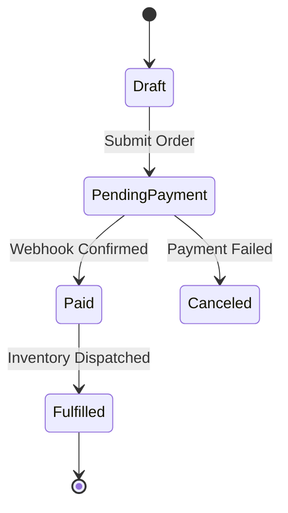

# Domains

> [!IMPORTANT]
> **Strict Reservation Notice**: The **`domain-*`** skill prefix is
> **strictly reserved for the author and maintainers of the instantiated project**. The
> Zenith template intentionally includes **zero** `domain-*` skills out-of-the-box,
> ensuring that your application domain namespace remains clean, unpolluted, and free of
> naming collisions with upstream template updates.

---

## What Are Domain Skills?

While generic AI coding assistants understand Python syntax, pytest fixtures, and
standard library modules, they have
**zero context about your proprietary business domain**.

Without domain guidance, autonomous AI agents tend to:

- Make invalid assumptions about customer billing calculations or subscription tiers.
- Invent unauthorized order state transitions.
- Misunderstand tenant isolation or authentication boundaries.
- Implement business logic that violates regulatory compliance (e.g. HIPAA, GDPR,
  PCI-DSS).

**Domain Skills (`domain-*`) solve this by codifying your business rules, domain
invariants, entity lifecycles, and proprietary service logic into structured runbooks
that AI agents load when working on domain code.**

---

## Anatomy of a Domain Skill

Domain skills follow the standard Zenith progressive disclosure architecture:

```tree
.agents/skills/domain-billing/
├── SKILL.md          # Core business rules, state transitions, calculation logic
├── templates/        # JSON payload schemas, webhook response templates
└── references/       # Payment gateway API specifications, pricing matrices
```

### Example Frontmatter

```yaml
---
name: domain-billing
description: >-
  Business logic, subscription tiers, prorating calculations, and webhook processing for customer billing.
  Use when modifying subscription models, invoice generators, Stripe webhook handlers, or pricing logic.
  Triggers: billing, subscription, invoice, stripe, pricing, prorate, refund, payment.
version: 1.0.0
---
```

---

## Recommended Patterns

### Invariant Tables

Define core domain constraints in clear, non-negotiable tables:

| Subscription Tier | Seat Limit | API Request Cap | Storage Quota |
|---|---|---|---|
| **Starter** | Up to 5 | 10,000 / month | 5 GB |
| **Professional** | Up to 25 | 100,000 / month | 50 GB |
| **Enterprise** | Unlimited | Custom | Unlimited |

### State Machine Lifecycles

Document valid state transitions so agents never introduce illegal states:



### Edge Case Matrices

Document how the domain handles boundary conditions (e.g., Leap year billing, fractional
cent rounding, concurrent subscription upgrades).

---

## Common Domain Skills

Here are typical domain skills you can scaffold in your Zenith project:

- **`domain-auth`**: Session lifecycles, JWT claims, OAuth2 token refreshing, and RBAC
  permission hierarchies.
- **`domain-billing`**: Subscription models, tax calculation rules, discount codes, and
  payment retry schedules.
- **`domain-order-fulfillment`**: Cart checkout workflows, shipping provider
  dispatching, and refund approval thresholds.
- **`domain-data-ingestion`**: Sensor telemetry normalization, schema migration
  invariants, and dead-letter queue routing.
- **`domain-compliance`**: PII masking protocols, audit log retention requirements, and
  data export contracts.

---

## Authoring Domain Skills

Use the
[Skill Creator (`workflow-skill-creator`)](workflow.md#skill-authoring--standards-workflow-skill-creator)
workflow:

1. Create the skill directory:

   ```bash
   mkdir -p .agents/skills/domain-<name>/{templates,references}
   ```

2. Author `SKILL.md` with active voice, concise rules, and explicit triggers following
   [ASD-STE100](guide.md#simplified-technical-english-guide-ste100).
3. Register the skill in your project's `AGENTS.md`.
4. Validate compliance:

   ```bash
   uv run poe check-skills
   ```
