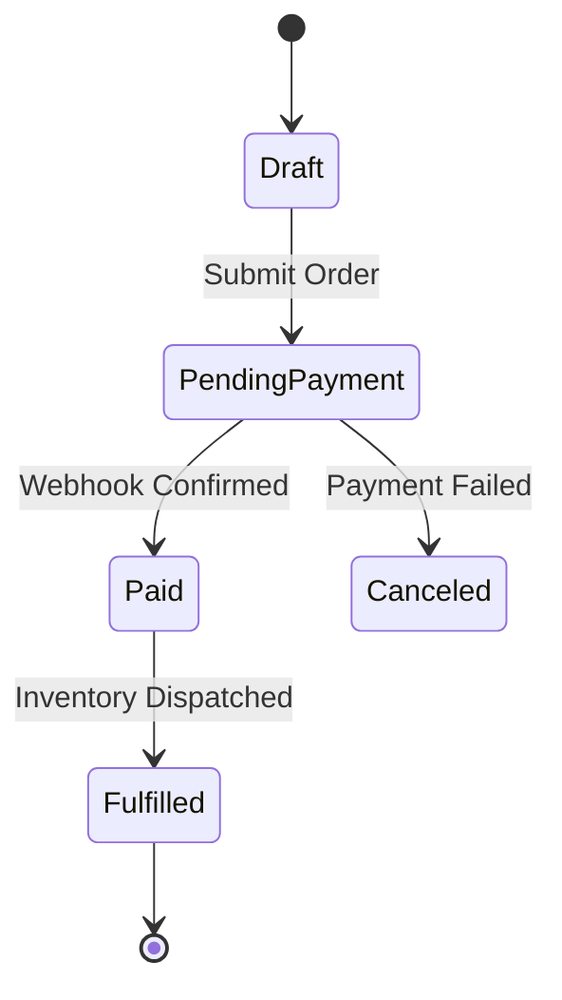

# Domains

> [!IMPORTANT]
> **Reserved Namespace**: The **`domain-*`** skill prefix is reserved exclusively for
> the authors of generated projects. Zenith ships zero `domain-*` skills out of the box
> so your application's business rules never collide with upstream template updates.

## Purpose of Domain Skills

AI coding assistants know Python syntax and standard libraries, but they have no prior
knowledge of your proprietary business rules—such as pricing tiers, legal state
transitions, tenant isolation boundaries, or regulatory constraints (HIPAA, GDPR,
PCI-DSS).

**Domain skills (`domain-*`)** capture those business invariants in `.agents/skills/` so
agents load them automatically when editing domain modules.

## Directory Layout & Frontmatter

Domain skills use the same progressive disclosure layout as built-in skills:

```tree
.agents/skills/domain-billing/
├── SKILL.md          # Core business rules, state transitions, and invariants
├── templates/        # JSON payload schemas or webhook fixtures
└── references/       # Gateway API specs and pricing tables
```

### Example Frontmatter

```yaml
---
name: domain-billing
description: >-
  Business logic, subscription tiers, prorating calculations, and webhook processing
  for customer billing. Use when modifying subscription models, invoice generators,
  Stripe webhook handlers, or pricing logic.
  Triggers: billing, subscription, invoice, stripe, pricing, prorate, refund, payment.
version: 1.0.0
---
```

## Structuring Domain Rules

Use tables and state diagrams so agents can apply domain constraints without guessing.

### 1. Invariant Tables

Express tier limits, quotas, and rounding rules as tables rather than prose paragraphs:

| Subscription Tier | Seat Limit | API Request Cap | Storage Quota |
| :---------------- | :--------- | :-------------- | :------------ |
| **Starter**       | Up to 5    | 10,000 / month  | 5 GB          |
| **Professional**  | Up to 25   | 100,000 / month | 50 GB         |
| **Enterprise**    | Unlimited  | Custom          | Unlimited     |

### 2. State Machine Lifecycles

Define valid entity state transitions in a Mermaid state diagram so agents never add
unauthorized transitions:



### 3. Boundary & Edge-Case Rules

List concrete edge cases (for example, leap-year billing periods, half-to-even currency
rounding, idempotency keys on webhook retries) and link to the corresponding domain
models in `src/`.

## Creating a Domain Skill

Follow [`workflow-skill-creator`](workflow.md#skill-authoring-workflow-skill-creator):

1. Create the skill directory:

   ```bash
   mkdir -p .agents/skills/domain-<name>/{templates,references}
   ```

2. Write `.agents/skills/domain-<name>/SKILL.md` following
   [ASD-STE100](guide.md#simplified-technical-english-guide-ste100).
3. Add the skill to the domain activation list in your project's `AGENTS.md`.
4. Validate frontmatter and STE-100 rules:

   ```bash
   uv run poe lint-ste
   uv run poe check-skills
   ```
