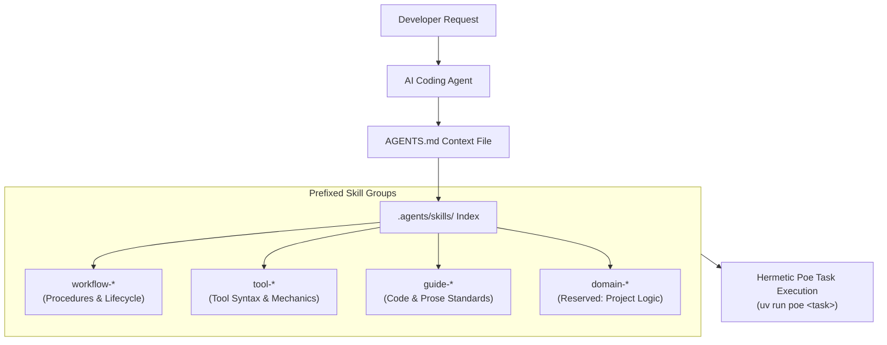

# Agent Skills Architecture

Zenith provides a first-class framework for autonomous AI coding agents (Claude Code,
Google Gemini CLI, Antigravity, OpenAI Codex, Cursor, Windsurf, Aider).

Rather than relying on vague prompts or unbounded system prompts, Zenith organizes all
agent capabilities into **modular, prefixed Agent Skills** located in `.agents/skills/`.

---

## Skill Taxonomy

To prevent naming collisions, maintain predictable agent discovery, and separate
template capabilities from project domain logic, Zenith standardizes on a
**limited set of 4 skill prefixes**:

| Prefix Group | Scope & Purpose | Examples |
|---|---|---|
| **[`workflow-*`](workflow.md)** | **Lifecycle & Multi-Step Procedures** Operational processes, version control, release ceremonies, architecture records, code review audits, and Spec-Driven Development. | `workflow-git`, `workflow-code-review`, `workflow-sdd`, `workflow-changelog`, `workflow-adr`, `workflow-setup`, `workflow-skill-creator`. |
| **[`tool-*`](tool.md)** | **Tool Mechanics & Tooling Reference** Concrete command syntax, CLI flags, configuration details, and runbooks for specific developer tools and libraries. | `tool-uv`, `tool-ruff`, `tool-pyrefly`, `tool-tach`, `tool-pytest`, `tool-zensical`, etc. |
| **[`guide-*`](guide.md)** | **Engineering Conventions & Style** Coding style conventions, architecture invariants, type parameter rules, and technical writing standards. | `guide-python`, `guide-ste100`. |
| **[`domain-*`](domain.md)** | **Project Domain & Business Rules** **Reserved exclusively for the author of the instantiated project.** Documents business rules, domain entities, APIs, and workflows. | `domain-billing`, `domain-auth`, `domain-data-pipeline`. |

> [!IMPORTANT]
> **The `domain-*` prefix is strictly reserved for you**: The Zenith template ships with
> zero `domain-*` skills out-of-the-box. When you scaffold a new repository using
> Zenith, you and your team can create `domain-*` skills to codify your business logic,
> vendor integrations, and proprietary domain models without any risk of colliding with
> template updates or upstream tooling skills.

---

## Skill Discovery

Agent tools auto-discover skills through progressive disclosure:

1. **Context Discovery**: The agent reads root `AGENTS.md` (or symlinks `CLAUDE.md`,
   `.cursorrules`, `.windsurfrules`).
2. **Progressive Disclosure**: The runner initially loads only the skill `name` and
   `description` frontmatter. Full procedural instructions and templates are loaded into
   context **only when that skill is activated**.
3. **Execution Grounding**: The agent follows the skill's step-by-step instructions and
   executes tasks inside the hermetic project environment with `uv run poe <task>`.

---

## Skill Groups

Explore the dedicated documentation pages for each skill group:

- **[Workflows](workflow.md)**: Release engineering, git hygiene, pre-flight audits,
  ADRs, environment setup, and skill creation.
- **[Tools](tool.md)**: Direct syntax runbooks for all developer tools integrated into
  Zenith.
- **[Guides](guide.md)**: Modern Python 3.12+ engineering conventions and Simplified
  Technical English (ASD-STE100) writing rules.
- **[Domains](domain.md)**: Guidelines for project authors on adding custom
  domain-specific skills.
