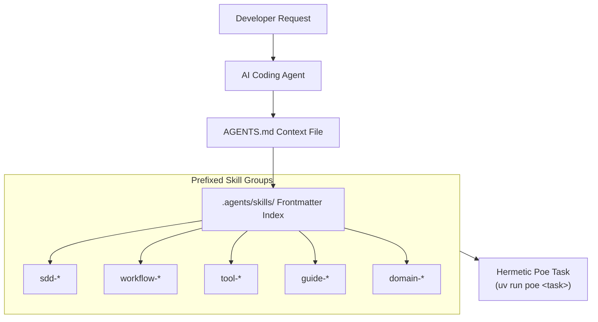

# Agent Skills Architecture

Zenith organizes instructions for AI coding agents into a root `AGENTS.md` context file
and modular, prefixed skills under `.agents/skills/`.

> [!NOTE]
> **Elective AI Tooling & Skills**: All AI configuration files and skills are optional
> during project generation. You can scaffold all supported assistants (`all`), popular
> defaults (`recommended`), form-factor subsets (`ide-only`, `cli-only`), a custom list
> (`claude, cursor`), universal context files only (`minimal`), or omit AI assets
> completely (`none` with `--no-skills`).

## Agentic Tool Compatibility Matrix

The table below lists all 14 supported AI coding tools, the configuration files
generated for each tool, and their current verification status:

| Tool                   | Category                   | Scaffolded Configuration Files                                          | Supported | Tested      | Integration Highlights                                                                                                                      |
| :--------------------- | :------------------------- | :---------------------------------------------------------------------- | :-------: | :---------: | :------------------------------------------------------------------------------------------------------------------------------------------ |
| **Google Antigravity** | Autonomous IDE & CLI Agent | `.gemini/settings.json` `.gemini/agents/*.md` `AGENTS.md`       | ✅ Yes    | ✅ Yes      | Explicitly tested; native `AGENTS.md` context discovery, subagent symlinks, hermetic task execution.                                        |
| **OpenAI Codex CLI**   | Autonomous Terminal Agent  | `.codex/config.toml` `.codex/agents/*.toml` `AGENTS.md`         | ✅ Yes    | ✅ Yes      | Explicitly tested; auto-fallback doc discovery, `workspace-write` sandbox, native TOML subagent definitions.                                |
| **OpenCode**           | Autonomous Terminal & TUI  | `opencode.json` `.opencode/agents/*.md` `AGENTS.md`             | ✅ Yes    | ✅ Yes      | Dedicated `opencode.json` permissions pre-authorizing hermetic tasks; subagent symlinks in `.opencode/agents/`; native `AGENTS.md` context. |
| **Claude Code**        | Autonomous Terminal Agent  | `CLAUDE.md` `.claude/settings.json` `.claude/agents/*.md`       | ✅ Yes    | ⏳ Untested | `CLAUDE.md` root symlink, pre-approved hermetic task permissions (`uv run poe:*`), dangerous command denies, subagent symlinks.             |
| **Google Gemini CLI**  | Autonomous Terminal Agent  | `.gemini/settings.json` `.gemini/agents/*.md` `AGENTS.md`       | ✅ Yes    | ⏳ Untested | Auto-configured `contextFileName: "AGENTS.md"`, subagent symlinks, modular skill discovery.                                                 |
| **Cursor**             | AI-Native IDE              | `.cursorrules` `.cursor/rules/zenith.mdc` `.cursor/agents/*.md` | ✅ Yes    | ⏳ Untested | Root `.cursorrules` symlink, always-on `.cursor/rules/zenith.mdc` (`globs: ["*"]`), subagent symlinks.                                      |
| **Windsurf**           | AI-Native IDE              | `.windsurfrules` `AGENTS.md`                                        | ✅ Yes    | ⏳ Untested | Root `.windsurfrules` symlink resolving directly to canonical `AGENTS.md`.                                                                  |
| **Aider**              | Terminal Pair Programmer   | `.aider.conf.yml` `AGENTS.md`                                       | ✅ Yes    | ⏳ Untested | Auto-reads `AGENTS.md`, pre-wires `lint-cmd` (`uv run poe fix`) and `test-cmd` (`uv run poe test`).                                         |
| **GitHub Copilot**     | IDE Extension & CLI        | `.github/copilot-instructions.md` `AGENTS.md`                       | ✅ Yes    | ⏳ Untested | Canonical workspace instruction pointer directing Copilot chat and completions to `AGENTS.md`.                                              |
| **Devin**              | Autonomous Cloud Agent     | `.devin/config.json` `AGENTS.md`                                    | ✅ Yes    | ⏳ Untested | Dedicated `.devin/config.json` pre-authorizing hermetic tasks (`uv run poe:*`, `pytest:*`, `prek:*`) and auto-ingesting root `AGENTS.md`.   |
| **Zed**                | AI-Native IDE              | `.zed/settings.json` `.zed/tasks.json` `AGENTS.md`              | ✅ Yes    | ⏳ Untested | Dedicated `.zed/settings.json` configuring Ruff formatting and `.zed/tasks.json` for Poe tasks; auto-reads `AGENTS.md`.                     |
| **Pi**                 | Autonomous Terminal Agent  | `.pi/settings.json` `.pi/APPEND_SYSTEM.md` `AGENTS.md`          | ✅ Yes    | ⏳ Untested | Dedicated `.pi/settings.json` and `.pi/APPEND_SYSTEM.md` symlinked to `AGENTS.md` for automatic system instruction injection.               |
| **Oh My Pi**           | Autonomous Terminal Agent  | `.omp/SYSTEM.md` `AGENTS.md`                                        | ✅ Yes    | ⏳ Untested | Dedicated `.omp/SYSTEM.md` symlinked to `AGENTS.md` for automatic system instruction injection; executes hermetic Poe tasks.                |
| **Hermes Agent**       | Autonomous Skill Engine    | `HERMES.md` `AGENTS.md`                                             | ✅ Yes    | ⏳ Untested | Root `HERMES.md` symlink resolving to `AGENTS.md` for priority context discovery; discovers repository skills via toolsets.                 |

> [!NOTE]
> **Verification Status**:
>
> - **Supported**: `hooks/post_gen_project.py` scaffolds dedicated configuration files,
>   permission rules, subagent definitions, or symlinks for the tool.
> - **Tested**: Verified in live interactive sessions by project maintainers in addition
>   to automated template tests.
> - **Untested**: Configuration files and symlinks are verified by automated template
>   tests, awaiting live interactive session sign-off.

### Shared Architectural Invariants

1. **Single Source of Truth (`AGENTS.md`)**: Every tool resolves instructions back to
   root `AGENTS.md`, either natively or through symlinks (`CLAUDE.md`, `.cursorrules`,
   `.windsurfrules`, `HERMES.md`, `.pi/APPEND_SYSTEM.md`, `.omp/SYSTEM.md`).
2. **Subagent Specialization**: Where supported (Antigravity, Claude Code, Gemini CLI,
   Cursor, Codex, OpenCode), Zenith links or compiles specialized subagent definitions
   (`sdd-specifier`, `sdd-planner`, `sdd-implementer`, `sdd-reviewer`) from
   `.agents/subagents/`.
3. **Hermetic Task Sandboxing**: Pre-authorized permission profiles scope agent command
   execution to `uv run poe <task>`, keeping local and CI runs identical.

## Skill Taxonomy

Zenith uses **5 skill prefixes** so built-in tooling skills never collide with
application domain rules:

| Prefix Group                    | Scope & Purpose                                                                                                                               | Examples                                                                                                                                                                       |
| :------------------------------ | :-------------------------------------------------------------------------------------------------------------------------------------------- | :----------------------------------------------------------------------------------------------------------------------------------------------------------------------------- |
| **[`sdd-*`](sdd.md)**           | **Spec-Driven Development Suite** Specification authoring, technical planning, TDD implementation, and adversarial review.                | `sdd`, `sdd-spec`, `sdd-plan`, `sdd-implement`, `sdd-review`                                                                                                                   |
| **[`workflow-*`](workflow.md)** | **Lifecycle & Multi-Step Procedures** Version control, code review audits, changelogs, ADRs, environment setup, and doc authoring.        | `workflow-git`, `workflow-code-review`, `workflow-changelog`, `workflow-adr`, `workflow-setup`, `workflow-skill-creator`, `workflow-docs-authoring`, `workflow-docs-consumers` |
| **[`tool-*`](tool.md)**         | **Tool Mechanics & CLI Reference** Verified CLI flags, configuration file paths, and Poe task aliases for stack tools.                    | `tool-uv`, `tool-ruff`, `tool-pyrefly`, `tool-tach`, `tool-pytest`, `tool-zensical`, and others                                                                                |
| **[`guide-*`](guide.md)**       | **Engineering Conventions & Style** Modern Python 3.12+ architecture conventions and ASD-STE100 controlled English for skills/docstrings. | `guide-python`, `guide-ste100`                                                                                                                                                 |
| **[`domain-*`](domain.md)**     | **Project Domain & Business Rules** **Reserved for the generated project.** Codifies proprietary business logic, entities, and APIs.      | `domain-billing`, `domain-auth`, `domain-data-pipeline`                                                                                                                        |

> [!IMPORTANT]
> **The `domain-*` namespace is reserved for your project**: Zenith ships zero
> `domain-*` skills so your team can add business-logic skills without any risk of
> colliding with upstream template updates.

## Progressive Disclosure & Activation Modes

Agents discover and load skills in three stages:

1. **Context Discovery**: The agent reads root `AGENTS.md` on session startup.
2. **Frontmatter Indexing**: Only the `name` and `description` YAML frontmatter of each
   `.agents/skills/*/SKILL.md` file is indexed initially. Full instructions, templates,
   and scripts are read into context only when a skill is activated.
3. **Hermetic Execution**: The agent follows the activated skill's workflow and runs
   verification gates via `uv run poe <task>`.

### Activation Modes

| Mode            | How It Activates                                                                                | Skills                                                                                                                                                                            |
| :-------------- | :---------------------------------------------------------------------------------------------- | :-------------------------------------------------------------------------------------------------------------------------------------------------------------------------------- |
| **Mandatory**   | Loaded automatically whenever the agent works in the matching domain, even without a prompt tag | `guide-python`, `guide-ste100`, `workflow-git`, `workflow-code-review`, `workflow-adr`, `workflow-changelog`, `workflow-docs-authoring`, `workflow-skill-creator`, `sdd-*` phases |
| **On demand**   | Loaded when a task or tool diagnostic matches the skill's triggers                              | All `tool-*` skills, `sdd`                                                                                                                                                        |
| **Manual only** | Never self-activated (`disable-model-invocation: true`); requires explicit user request         | `workflow-setup`, `workflow-docs-consumers` (plus `workflow-inspect-repo` and `workflow-example-sync` in the upstream Zenith repository)                                          |

## Skill Reference Pages

- **[Spec-Driven Development (`sdd-*`)](sdd.md)**: Phased specification, planning, TDD
  implementation, and review workflows.
- **[Workflows (`workflow-*`)](workflow.md)**: Operational procedures for Git, code
  review, changelogs, ADRs, and documentation.
- **[Tools (`tool-*`)](tool.md)**: Reference catalog of tool runbooks and CLI mechanics.
- **[Guides (`guide-*`)](guide.md)**: Python 3.12+ style rules and ASD-STE100 writing
  standards.
- **[Domains (`domain-*`)](domain.md)**: How to create project-specific business-logic
  skills.
