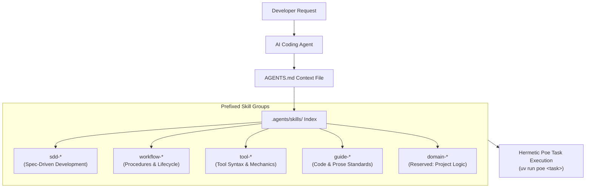

# Agent Skills Architecture

Zenith provides a first-class framework for autonomous AI coding agents (Claude Code,
Google Gemini CLI, Antigravity, OpenAI Codex, Cursor, Windsurf, Aider).

Rather than relying on vague prompts or unbounded system prompts, Zenith organizes all
agent capabilities into **modular, prefixed Agent Skills** located in `.agents/skills/`.

> [!NOTE]
> **Elective AI Tooling & Skills**: The entire AI tooling stack is 100% elective during
> project scaffolding. You can choose all supported tools, select specific assistants
> (for example, `claude, cursor`), use universal context files only (`minimal`), or
> exclude AI tooling entirely (`none`).
>
> The strict quality gates—100% branch test coverage, strict Pyrefly static typing,
> and architectural boundaries—protect the codebase equally whether changes are written
> by human hands, autonomous agents, or collaborative pair programming.

## Agentic Tool Compatibility Matrix

Zenith projects operate with modern autonomous coding agents, terminal assistants, and
AI-native IDEs out of the box when enabled. During project scaffolding, the `ai_tools`
prompt lets you select all tools (`all`), popular tools (`recommended`), targeted form
factors (`ide-only`, `cli-only`), custom tool combinations, universal context only
(`minimal`), or completely exclude AI tooling (`none`).

The table below audits popular AI coding tools, their scaffolded configuration
assets, their support level in Zenith, and their current verification status:

| Tool                   | Category                   | Scaffolded Configuration Files                                          | Supported | Tested      | Integration Highlights                                                                                                                      |
| :--------------------- | :------------------------- | :---------------------------------------------------------------------- | :-------: | :---------: | :------------------------------------------------------------------------------------------------------------------------------------------ |
| **Google Antigravity** | Autonomous IDE & CLI Agent | `.gemini/settings.json` `.gemini/agents/*.md` `AGENTS.md`       | ✅ Yes    | ✅ Yes      | Explicitly tested; native `AGENTS.md` context discovery, subagent symlinks, hermetic task execution.                                        |
| **OpenAI Codex CLI**   | Autonomous Terminal Agent  | `.codex/config.toml` `.codex/agents/*.toml` `AGENTS.md`         | ✅ Yes    | ✅ Yes      | Explicitly tested; auto-fallback doc discovery, `workspace-write` sandbox, native TOML subagent definitions.                                |
| **OpenCode**           | Autonomous Terminal & TUI  | `opencode.json` `.opencode/agents/*.md` `AGENTS.md`             | ✅ Yes    | ✅ Yes      | Dedicated `opencode.json` permissions pre-authorizing hermetic tasks; subagent symlinks in `.opencode/agents/`; native `AGENTS.md` context. |
| **Claude Code**        | Autonomous Terminal Agent  | `CLAUDE.md` `.claude/settings.json` `.claude/agents/*.md`       | ✅ Yes    | ⏳ Untested | `CLAUDE.md` root symlink, pre-approved hermetic task permissions (`uv run poe:*`), dangerous command denies, subagent symlinks.             |
| **Google Gemini CLI**  | Autonomous Terminal Agent  | `.gemini/settings.json` `.gemini/agents/*.md` `AGENTS.md`       | ✅ Yes    | ⏳ Untested | Auto-configured `contextFileName: "AGENTS.md"`, subagent symlinks, modular skill discovery.                                                 |
| **Cursor**             | AI-Native IDE              | `.cursorrules` `.cursor/rules/zenith.mdc` `.cursor/agents/*.md` | ✅ Yes    | ⏳ Untested | Root `.cursorrules` symlink, always-on `.cursor/rules/zenith.mdc` (`globs: ["*"]`), subagent symlinks.                                      |
| **Windsurf**           | AI-Native IDE              | `.windsurfrules` `AGENTS.md`                                        | ✅ Yes    | ⏳ Untested | Root `.windsurfrules` symlink resolving directly to canonical `AGENTS.md`.                                                                  |
| **Aider**              | Terminal Pair Programmer   | `.aider.conf.yml` `AGENTS.md`                                       | ✅ Yes    | ⏳ Untested | Auto-reads `AGENTS.md`, pre-wires `lint-cmd` (`uv run poe fix`) and `test-cmd` (`uv run poe test`).                                         |
| **GitHub Copilot**     | IDE Extension & CLI        | `.github/copilot-instructions.md` `AGENTS.md`                       | ✅ Yes    | ⏳ Untested | Canonical workspace instruction pointer directing Copilot chat and completions to `AGENTS.md`.                                              |
| **Devin**              | Autonomous Cloud Agent     | `.devin/config.json` `AGENTS.md`                                    | ✅ Yes    | ⏳ Untested | Dedicated `.devin/config.json` pre-authorizing hermetic tasks (`uv run poe:*`, `pytest:*`, `prek:*`) and auto-ingesting root `AGENTS.md`.   |
| **Zed**                | AI-Native IDE              | `.zed/settings.json` `.zed/tasks.json` `AGENTS.md`              | ✅ Yes    | ⏳ Untested | Dedicated `.zed/settings.json` configuring Ruff formatting and `.zed/tasks.json` for Poe tasks; auto-reads `AGENTS.md`.                     |
| **Pi**                 | Autonomous Terminal Agent  | `.pi/settings.json` `.pi/APPEND_SYSTEM.md` `AGENTS.md`          | ✅ Yes    | ⏳ Untested | Dedicated `.pi/settings.json` and `.pi/APPEND_SYSTEM.md` symlinked to `AGENTS.md` for automatic system instruction injection.               |
| **Oh My Pi**           | Autonomous Terminal Agent  | `.omp/SYSTEM.md` `AGENTS.md`                                        | ✅ Yes    | ⏳ Untested | Dedicated `.omp/SYSTEM.md` symlinked to `AGENTS.md` for automatic system instruction injection; executes hermetic Poe tasks.                |
| **Hermes Agent**       | Autonomous Skill Engine    | `HERMES.md` `AGENTS.md`                                             | ✅ Yes    | ⏳ Untested | Root `HERMES.md` symlink resolving to `AGENTS.md` for priority context discovery; discovers repository skills via toolsets.                 |

> [!NOTE]
> **Status Explanations**:
>
> - **Supported**: The Zenith project generator (`hooks/post_gen_project.py` and
>   template assets) automatically scaffolds dedicated configuration files, permission
>   rules, subagent definitions, or instruction symlinks.
> - **Partial**: The tool functions with Zenith through manual or generic context
>   discovery (such as referencing `AGENTS.md`), but Zenith does not scaffold a
>   dedicated, tool-specific configuration file out of the box.
> - **Tested**: The tool has been explicitly tested and verified in interactive
>   development sessions by project maintainers.
> - **Untested**: Configuration files and integration hooks are generated and verified
>   by template unit tests, but live end-to-end interactive developer sessions have not
>   yet been formally conducted.

### Audit Summary & Verified Workflows

Zenith maintains first-class support for autonomous coding agents by enforcing three
architectural invariants across all supported tools:

1. **Deterministic Single Source of Truth**: Every tool resolves instructions back to
   the canonical `AGENTS.md` at the repository root, either natively or via symbolic
   links (`CLAUDE.md`, `.cursorrules`, `.windsurfrules`, `.cursor/rules/zenith.mdc`,
   `.github/copilot-instructions.md`).
2. **Subagent Specialization**: Where supported (Claude Code, Google Gemini CLI,
   Antigravity, Cursor, OpenAI Codex, OpenCode), Zenith links or compiles specialized
   subagent personas (`sdd-specifier`, `sdd-planner`, `sdd-implementer`, `sdd-reviewer`)
   from `.agents/subagents/`.
3. **Hermetic Task Sandboxing**: Tools operate within isolated environment boundaries
   using `uv run poe <task>`, preventing dependency pollution and ensuring identical
   execution between local agents, developers, and CI pipelines.

#### Explicitly Tested Tools

- **Google Antigravity**:
  - Validated with Antigravity IDE and `agy` CLI environments.
  - Verifies auto-discovery of `AGENTS.md` via `.gemini/settings.json`.
  - Subagents in `.gemini/agents/` execute Spec-Driven Development tasks with full tool
    calling, hermetic testing, and quality verification gates.
- **OpenAI Codex CLI**:
  - Validated with the OpenAI Codex CLI runner.
  - Verifies project instruction loading through
    `project_doc_fallback_filenames = ["AGENTS.md", "CLAUDE.md"]`.
  - Verifies `workspace-write` sandbox confinement and `on-request` approval policies.
  - Verifies native `.codex/agents/*.toml` subagent declarations.
- **OpenCode**:
  - Validated with the OpenCode CLI / TUI environment.
  - Verifies auto-discovery of `AGENTS.md` at project root.
  - Verifies command permissions and task pre-authorizations via `opencode.json`.
  - Subagents in `.opencode/agents/` execute Spec-Driven Development tasks with hermetic
    task execution and quality verification gates.

## Skill Taxonomy

To prevent naming collisions, maintain predictable agent discovery, and separate
template capabilities from project domain logic, Zenith standardizes on
**5 distinct skill prefixes**:

| Prefix Group                    | Scope & Purpose                                                                                                                                                                     | Examples                                                                                                                                                                        |
| ------------------------------- | ----------------------------------------------------------------------------------------------------------------------------------------------------------------------------------- | ------------------------------------------------------------------------------------------------------------------------------------------------------------------------------- |
| **[`sdd-*`](sdd.md)**           | **Spec-Driven Development Suite** Authoring specifications, technical planning, TDD implementation, and verification reviews.                                                   | `sdd`, `sdd-spec`, `sdd-plan`, `sdd-implement`, `sdd-review`.                                                                                                                   |
| **[`workflow-*`](workflow.md)** | **Lifecycle & Multi-Step Procedures** Operational processes, version control, release ceremonies, architecture records, code review audits, skill authoring, and documentation. | `workflow-git`, `workflow-code-review`, `workflow-changelog`, `workflow-adr`, `workflow-setup`, `workflow-skill-creator`, `workflow-docs-authoring`, `workflow-docs-consumers`. |
| **[`tool-*`](tool.md)**         | **Tool Mechanics & Tooling Reference** Concrete command syntax, CLI flags, configuration details, and runbooks for specific developer tools and libraries.                      | `tool-uv`, `tool-ruff`, `tool-pyrefly`, `tool-tach`, `tool-pytest`, `tool-zensical`, and others.                                                                                |
| **[`guide-*`](guide.md)**       | **Engineering Conventions & Style** Coding style conventions, architecture invariants, type parameter rules, and technical writing standards.                                   | `guide-python`, `guide-ste100`.                                                                                                                                                 |
| **[`domain-*`](domain.md)**     | **Project Domain & Business Rules** **Reserved exclusively for the author of the instantiated project.** Documents business rules, domain entities, APIs, and workflows.        | `domain-billing`, `domain-auth`, `domain-data-pipeline`.                                                                                                                        |

> [!IMPORTANT]
> **The `domain-*` prefix is strictly reserved for you**: The Zenith template ships with
> zero `domain-*` skills out-of-the-box. When you scaffold a new repository using
> Zenith, you and your team can create `domain-*` skills to codify your business logic,
> vendor integrations, and proprietary domain models without any risk of colliding with
> template updates or upstream tooling skills.

## Skill Discovery

Agent tools auto-discover skills through progressive disclosure:

1. **Context Discovery**: The agent reads root `AGENTS.md` (or symlinks `CLAUDE.md`,
   `.cursorrules`, `.windsurfrules`).
2. **Progressive Disclosure**: The runner initially loads only the skill `name` and
   `description` frontmatter. Full procedural instructions and templates are loaded into
   context **only when that skill is activated**.
3. **Execution Grounding**: The agent follows the skill's step-by-step instructions and
   executes tasks inside the hermetic project environment with `uv run poe <task>`.

### How Skills Work in Action: a 3-Step Walkthrough

Here is how an everyday developer interaction looks when pairing with an AI coding
assistant:

1. **Step 1: Developer Request**: In your editor chat or terminal (Claude Code, Cursor,
   Copilot, Gemini CLI), you submit an intent:
   > *"Draft a technical specification for our new stripe billing webhook following
   > `sdd-spec`."*
2. **Step 2: Skill Activation**: The assistant inspects `AGENTS.md`, activates
   `.agents/skills/sdd-spec/SKILL.md`, and adopts its structured EARS specification
   format and artifact boundaries.
3. **Step 3: Execution & Verification**: The assistant writes the specification
   document, executes local Poe tasks to verify syntax (`uv run poe code-quality`), and
   presents the draft for human review.

## Skill Groups

Explore the dedicated documentation pages for each skill group:

- **[Spec-Driven Development](sdd.md)**: Structured specifications, technical planning,
  TDD implementation, and verification reviews.
- **[Workflows](workflow.md)**: Release engineering, git hygiene, pre-flight audits,
  ADRs, environment setup, and skill creation.
- **[Tools](tool.md)**: Direct syntax runbooks for all developer tools integrated into
  Zenith.
- **[Guides](guide.md)**: Modern Python 3.12+ engineering conventions and Simplified
  Technical English (ASD-STE100) writing rules.
- **[Domains](domain.md)**: Guidelines for project authors on adding custom
  domain-specific skills.
