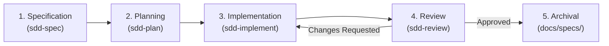

# Spec-Driven Development (SDD) Suite

The **Spec-Driven Development (`sdd-*`)** suite replaces ad-hoc prompt loops with
versioned markdown contracts under `.specs/<feature-id>/`. Instead of jumping straight
from a prompt to code, agents draft a specification, decompose an architectural plan,
implement tasks with strict TDD, and audit the result before archival.

## Lifecycle & Core Invariants

1. **Three Feature Artifacts**: Each feature is tracked in `.specs/<feature-id>/`:
   - `spec.md`: User stories, EARS functional requirements (`REQ-001`, ...), scope
     boundaries, and acceptance scenarios.
   - `plan.md`: Component architecture, Tach layer mapping, public interfaces, and
     atomic tasks (`<= 100` lines per task).
   - `review.md`: Requirement-to-test traceability matrix, Griffe public API diff, and
     audit verdict.
2. **Phase Isolation**: Specification, planning, implementation, and review run as
   separate phases (or isolated subagents) so implementation context does not pollute
   architectural review.
3. **Human Sign-Off vs. Autonomous Mode**:
   - **Supervised mode (default)**: Both `spec.md` and `plan.md` start as
     `Status: Draft`. Agents never self-approve artifacts; an explicit developer
     approval flips the status to `Approved` before `sdd-implement` can run.
   - **Autonomous mode (`--autonomous` or `/goal`)**: Runs end-to-end without manual
     stops unless an automated quality gate fails.
4. **Atomic Rollback**: If a task fails verification or drifts from the plan,
   `uv run poe sdd-revert <feature-id>` reverts the task commit and unchecks its item in
   `plan.md`.

## The Five SDD Skills

Each skill owns one stage of the specification-driven lifecycle.

### 1. Master Orchestrator (sdd)

Coordinates the feature lifecycle across phases, branch creation, subagent handoffs, and
final archival:

- **Fast-Path Mode**: For small features or bug fixes under 150 lines of diff, combines
  specification and planning into a single lightweight pass.
- **Archival**: Once `review.md` is approved, `uv run poe sdd-archive <feature-id>`
  moves completed specs from `.specs/<feature-id>/` into permanent documentation under
  `docs/specs/`.

### 2. Specification Authoring (sdd-spec)

Captures functional requirements in `.specs/<feature-id>/spec.md` before any design or
implementation code is written:

- **EARS Syntax**: Formats requirements using Easy Approach to Requirements Syntax
  patterns (`Ubiquitous`, `Event-Driven`, `State-Driven`, `Optional`, `Unwanted
  Behavior`) with unique IDs (`REQ-001`).
- **Explicit Scope**: Requires `In-Scope` and `Out-of-Scope` sections and clarifies
  ambiguous edge cases up front.
- **Validation**: `uv run poe sdd-check-spec <feature-id>` validates required sections
  and EARS requirement formatting.

### 3. Technical Planning (sdd-plan)

Translates an approved `spec.md` into `.specs/<feature-id>/plan.md`:

- **Python 3.12+ Contracts**: Specifies frozen slotted dataclasses, `typing.Protocol`
  interfaces, and PEP 695 generic signatures before implementation starts.
- **Layer Boundaries**: Maps every planned module to `tach.toml` layers (`cli -> core`)
  to prevent circular imports.
- **Atomic Tasks**: Breaks implementation into ordered tasks with explicit file targets
  and verification commands.

### 4. Test-Driven Implementation (sdd-implement)

Executes approved tasks in `plan.md` one at a time using a strict red-green-refactor
loop:

1. **Red**: Writes a failing test tagged with the requirement ID (`# REQ-001`) and
   confirms the test fails for the expected reason.
2. **Green**: Writes the minimal production code in `src/` to pass the test.
3. **Refactor & Verify**: Runs `uv run poe fix`, `uv run poe code-quality`, and
   `uv run poe test` (100% statement and branch coverage).
4. **Commit & Record**: Commits the completed task with a Conventional Commit message
   and records the commit SHA in `plan.md`.

### 5. Adversarial Verification (sdd-review)

Audits the finished implementation against `spec.md` and `plan.md` in
`.specs/<feature-id>/review.md`:

- **Public API Diff**: Runs `uv run poe sdd-check-api <feature-id>` (powered by Griffe)
  to detect unplanned public exports or breaking signature changes.
- **Traceability Matrix**: Runs `uv run poe sdd-check-traceability <feature-id>` to
  verify that every `REQ-XXX` identifier in `spec.md` maps to passing tests.
- **Chunked Diff Audit**: Splits diffs larger than 300 lines into file-by-file review
  batches, appending a `Review Fixes` phase to `plan.md` if changes are needed.

## SDD Poe Task Reference

| Command                                          | Phase         | Action                                                                  |
| :----------------------------------------------- | :------------ | :---------------------------------------------------------------------- |
| `uv run poe sdd-new <feature-id>`                | Specification | Create `feature/<feature-id>` branch and initialize `spec.md`           |
| `uv run poe sdd-check-spec <feature-id>`         | Specification | Lint `spec.md` for required sections and EARS syntax                    |
| `uv run poe sdd-plan <feature-id>`               | Planning      | Initialize `.specs/<feature-id>/plan.md` from template                  |
| `uv run poe sdd-review <feature-id>`             | Review        | Initialize `.specs/<feature-id>/review.md` from template                |
| `uv run poe sdd-check-api <feature-id>`          | Review        | Check public API changes against `plan.md` with Griffe                  |
| `uv run poe sdd-check-traceability <feature-id>` | Review        | Verify that all `REQ-XXX` requirements map to unit tests                |
| `uv run poe sdd-verify <feature-id>`             | Verification  | Run `sdd-check-spec`, `sdd-check-api`, `sdd-check-traceability`, `test` |
| `uv run poe sdd-revert <feature-id> [sha]`       | Rollback      | Revert a task commit and reset its checkbox in `plan.md`                |
| `uv run poe sdd-archive <feature-id>`            | Archival      | Move approved `.specs/<feature-id>/` artifacts into `docs/specs/`       |
