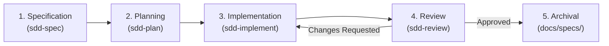

# Spec-Driven Development (SDD) Suite

The **Spec-Driven Development (SDD)** suite (`sdd-*`) is Zenith's core methodology
for high-assurance software engineering with autonomous AI coding agents.

Rather than relying on vague chat prompts or unbounded iterative edits, SDD treats
specifications as authoritative, versioned contracts. Code is a downstream artifact
generated from approved specifications.

---

## SDD Architecture & Invariants

1. **Artifact-Grounded Source of Truth**:
   Every feature lives in `.specs/<feature-id>/`:
   - `spec.md`: User stories, EARS functional requirements, acceptance scenarios.
   - `plan.md`: Component layout, public interfaces, frozen dataclasses, atomic tasks.
   - `review.md`: Traceability matrix, Griffe API diff, quality scorecard.
2. **Context Isolation**:
   Specification debates, architecture design, TDD implementation, and adversarial code
   reviews happen in distinct phases to prevent model distraction and context drift.
3. **Approval Stops**:
   By default (Supervised Mode), agents pause after specification, planning,
   implementation, and review for human sign-off before advancing.
4. **Autonomous Mode**: When `--autonomous` or `/goal` is passed, the suite executes
   end-to-end without pauses unless an automated gate fails.

---

## SDD Skills Reference

### `sdd` (Master Orchestrator)

- **Directory**: `.agents/skills/sdd/`
- **Triggers**: `sdd`, `spec driven dev`, `feature spec`, `execute sdd`.
- **Purpose**: Coordinates the full Spec-Driven Development lifecycle across feature
  development:
  - **Single Source of Truth**: Manages grounded artifacts in `.specs/<feature-id>/`.
  - **Approval Stops**: Stops for developer review after specification, plan,
    implementation, and review by default.
  - **Autonomous Mode**: Supports hands-off execution when `--autonomous` or `/goal` is
    specified.
  - **Fast-Path SDD**: Provides a compact workflow for small features and bug fixes
    under 150 lines of change.
  - **Permanent Archival**: Folds completed features into `docs/specs/` with
    `poe sdd-archive`.
  - **Task Rollback**: Cleanly reverts flawed task commits and resets plan checkboxes
    with `poe sdd-revert`.

---

### `sdd-spec`

- **Directory**: `.agents/skills/sdd-spec/`
- **Triggers**: `write spec`, `author spec`, `sdd spec`, `clarify requirements`.
- **Purpose**: Guides requirements clarification and specification drafting:
  - **EARS Patterns**: Enforces Easy Approach to Requirements Syntax for functional
    rules.
  - **Scope Boundaries**: Mandates explicit `In-Scope` and `Out-of-Scope` sections to
    prevent scope drift.
  - **Clarification Matrix**: Probes edge cases, state management, and error behaviors
    before coding.
  - **Automated Spec Linter**: Validates structure with
    `poe sdd-check-spec <feature-id>`.

---

### `sdd-plan`

- **Directory**: `.agents/skills/sdd-plan/`
- **Triggers**: `plan implementation`, `sdd plan`, `technical plan`, `task breakdown`.
- **Purpose**: Translates approved specifications into Python 3.12+ architectures:
  - **Architectural Rules**: Enforces frozen dataclasses, structural protocols, PEP 695
    generics, and Tach layer boundaries.
  - **Atomic Task Decomposition**: Breaks work into tasks under 100 lines with explicit
    verification gates.

---

### `sdd-implement`

- **Directory**: `.agents/skills/sdd-implement/`
- **Triggers**: `sdd implement`, `execute plan`, `tdd implementation`, `sdd coding`.
- **Purpose**: Directs sequential Test-Driven Development execution:
  - **Red-Green-Refactor Loop**: Writes failing test first, adds minimal code, then
    refactors and runs auto-fixers.
  - **Strict Task Order**: Enforces sequential execution without skipping ahead or
    batching tasks.
  - **Commit SHA Tracking**: Records Git commit hashes for each completed task directly
    in `plan.md` for auditability and automated rollback.
  - **Phase Checkpoints**: Enforces file-to-test coverage, quality gates, and manual
    verification recipes at phase boundaries before proceeding.

---

### `sdd-review`

- **Directory**: `.agents/skills/sdd-review/`
- **Triggers**: `sdd review`, `verify spec`, `audit implementation`, `spec conformance`.
- **Purpose**: Verifies implemented code against original specifications:
  - **Public API Diff**: Inspects breaking changes and unplanned symbols with Griffe
    (`poe sdd-check-api`).
  - **Traceability Matrix**: Enforces requirement-to-test mapping
    (`poe sdd-check-traceability`).
  - **Smart Diff Chunking**: Switches to file-by-file review mode on changes exceeding
    300 lines to prevent model attention degradation.
  - **Remediation Loop**: Appends a structured `Review Fixes` phase to `plan.md` when
    changes are requested, enabling immediate re-implementation.

---

## SDD Poe Task Runner Tasks

All SDD lifecycle commands are codified as Poe tasks:

| Command | Action |
|---|---|
| `uv run poe sdd-new <feature-id>` | Creates feature branch and initializes `.specs/<feature-id>/spec.md` |
| `uv run poe sdd-plan <feature-id>` | Initializes `.specs/<feature-id>/plan.md` from template |
| `uv run poe sdd-review <feature-id>` | Initializes `.specs/<feature-id>/review.md` from template |
| `uv run poe sdd-check-spec <feature-id>` | Runs automated AST and structure linter on `spec.md` |
| `uv run poe sdd-check-api <feature-id>` | Inspects public API breaking changes against `plan.md` with Griffe |
| `uv run poe sdd-check-traceability <feature-id>` | Validates that all `REQ-XXX` IDs map to passing test functions |
| `uv run poe sdd-verify <feature-id>` | Full convergence gate: spec check + API diff + traceability + tests |
| `uv run poe sdd-revert <feature-id> [sha]` | Reverts a task commit and resets checkbox in `plan.md` |
| `uv run poe sdd-archive <feature-id>` | Folds completed feature into permanent `docs/specs/<feature-id>/` |
