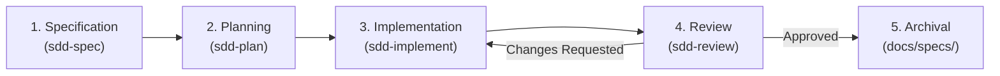

# Spec-Driven Development (SDD) Suite

The **Spec-Driven Development (SDD)** suite (`sdd-*`) is Zenith's core methodology
for high-assurance software engineering with autonomous AI coding agents.

Traditional agentic development often treats coding as a conversation: a developer
submits a loose prompt, the model guesses an implementation, errors occur, and both
parties spend hours playing conversational whack-a-mole. In contrast, SDD treats
**specifications as authoritative, versioned contracts**. Code is merely a downstream
artifact generated from approved specifications.

## The SDD Lifecycle & Invariants

SDD enforces four non-negotiable architectural invariants:

1. **Artifact-Grounded Source of Truth**: Every feature lives in `.specs/<feature-id>/`
   across three primary markdown artifacts:
   - `spec.md`: User stories, EARS functional requirements, and acceptance scenarios.
   - `plan.md`: Component layout, public interfaces, frozen dataclasses, and atomic
     tasks.
   - `review.md`: Requirement-to-test traceability matrix, Griffe API diff, and
     scorecard.
2. **Context Isolation**: Specification debates, architectural design, TDD
   implementation, and adversarial reviews take place in separate phases. This prevents
   context bloat and eliminates model distraction.
3. **Approval Stops vs. Autonomous Mode**:
   By default (Supervised Mode), agents pause after specification, planning,
   implementation, and review for human sign-off. When `--autonomous` or `/goal` is
   passed, the suite executes end-to-end without pausing unless an automated gate fails.
4. **Reversibility**: If an implementation task fails or introduces architectural drift,
   `poe sdd-revert` cleanly rolls back the commit and resets the plan checkbox without
   leaving dirty working trees.

## The Five SDD Skills

Each skill owns one stage of the specification-driven development lifecycle.

### Master Orchestrator (sdd)

**What it is**: The high-level workflow director that guides a feature from initial
concept to final archival across the entire SDD lifecycle.

**Why it's in Zenith**: Coordinating multiple specialized subagents, task boundaries,
Git branches, and verification gates manually is prone to human error. `sdd` provides a
deterministic state machine that orchestrates each phase, tracks feature progress, and
ensures no quality gates are bypassed.

Key capabilities include:

- **Lifecycle Orchestration**: Automates branch creation, directory initialization,
  agent handoffs, and final archival.
- **Fast-Path SDD**: Automatically scales down ceremony for small features and bug fixes
  (under 150 lines of change), combining specification and planning into a lean,
  single-step workflow.
- **Permanent Archival**: Upon approval, `uv run poe sdd-archive <feature-id>` folds
  completed specifications from `.specs/` into permanent repository documentation under
  `docs/specs/`, preserving institutional memory.
- **Task Rollback**: When a task fails quality gates or encounters architectural drift,
  `uv run poe sdd-revert <feature-id>` performs a non-destructive Git revert and
  restores the task checkbox in `plan.md`.

### Specification Authoring (sdd-spec)

**What it is**: The requirements elicitation and specification drafting skill that
captures user needs before any code is written.

**Why it's in Zenith**: AI models love jumping directly into code. When prompted with a
feature idea, agents typically make unstated assumptions about error behavior,
performance ceilings, and edge cases. `sdd-spec` forces active clarification *before*
writing code.

Core practices enforced by `sdd-spec`:

- **EARS Requirements Syntax**: Codifies requirements using Easy Approach to
  Requirements Syntax patterns (`Ubiquitous`, `Event-Driven`, `State-Driven`,
  `Optional`, `Unwanted Behavior`). Every requirement receives a unique identifier (such
  as `REQ-001`).
- **Strict Scope Boundaries**: Mandates explicit `In-Scope` and `Out-of-Scope` sections
  to prevent scope creep during implementation.
- **Clarification Matrix**: Proactively interviews the developer about edge cases, error
  handling, and backwards compatibility.
- **Automated Spec Linter**: Validates document structure and requirements syntax via
  `uv run poe sdd-check-spec <feature-id>`.

### Technical Planning & Architecture (sdd-plan)

**What it is**: The architectural planning skill that translates approved specifications
into typed Python 3.12+ component designs and atomic implementation tasks.

**Why it's in Zenith**: Large, unconstrained implementation tasks cause LLMs to lose
focus, skip edge cases, or introduce subtle type errors. `sdd-plan` decomposes features
into atomic, bite-sized tasks (under 100 lines of change each) with explicit
dependencies and verification commands.

Key architectural guardrails:

- **Zenith Engineering Alignment**: Enforces frozen slots dataclasses, structural
  protocols, PEP 695 generic syntax, and absolute imports across all proposed
  components.
- **Tach Layer Validation**: Maps proposed modules to Tach architectural boundaries to
  prevent illegal dependencies or circular imports before writing code.
- **Phase Milestones & Verification Recipes**: Groups tasks into logical phases with
  explicit checkpoints and manual test commands.

### Test-Driven Implementation (sdd-implement)

**What it is**: The sequential execution engine that implements plan tasks using strict
Test-Driven Development (TDD).

**Why it's in Zenith**: Unsupervised agents often write production code first and tests
later (or skip tests entirely), producing tests that mirror the implementation without
verifying real behavior. `sdd-implement` enforces a strict red-green-refactor loop.

Implementation protocol:

1. **Red**: Writes a minimal failing test tagged with the corresponding requirement ID
   (e.g., `# REQ-001`) and confirms the test fails as expected.
2. **Green**: Writes the minimal production code necessary to make the test pass.
3. **Refactor**: Formats and lints code automatically with `uv run poe fix`, verifying
   that type checking and 100% coverage remain intact.
4. **Commit Tracking**: Commits the verified task using Conventional Commits and records
   the Git commit SHA directly in `plan.md` for full auditability.
5. **Phase Checkpoints**: At phase boundaries, verifies 1:1 file-to-test coverage,
   executes manual verification commands, and stops for confirmation.

### Adversarial Verification & Review (sdd-review)

**What it is**: The independent quality gate that audits implemented code against the
original specification before merging.

**Why it's in Zenith**: An author cannot objectively audit their own work. When the same
agent context evaluates its own code, confirmation bias blinds it to breaking changes,
unplanned API exports, and untested edge cases. `sdd-review` acts as an adversarial
auditor.

Review capabilities:

- **Public API Diff Inspection**: Uses Griffe (`uv run poe sdd-check-api <feature-id>`)
  to detect breaking changes, modified function signatures, and unplanned exports
  against `plan.md`.
- **Traceability Verification**: Runs `uv run poe sdd-check-traceability <feature-id>`
  to guarantee that every functional requirement (`REQ-XXX`) maps to passing test
  functions.
- **Smart Diff Chunking**: For pull requests exceeding 300 lines of code, automatically
  switches from monolithic diff review to file-by-file chunked review to eliminate model
  attention degradation.
- **Remediation Loop**: If issues are found, appends a structured `Review Fixes` phase
  to `plan.md`, returning the feature to `sdd-implement` for targeted resolution.

## SDD Task Runner Quick Reference

The SDD workflow is driven entirely through hermetic Poe tasks:

| Command                                          | Lifecycle Stage | Action                                                                  |
| ------------------------------------------------ | --------------- | ----------------------------------------------------------------------- |
| `uv run poe sdd-new <feature-id>`                | Specification   | Creates feature branch and initializes `.specs/<feature-id>/spec.md`    |
| `uv run poe sdd-check-spec <feature-id>`         | Specification   | Lints `spec.md` for EARS syntax and required sections                   |
| `uv run poe sdd-plan <feature-id>`               | Planning        | Scaffolds `.specs/<feature-id>/plan.md` from the architectural template |
| `uv run poe sdd-review <feature-id>`             | Review          | Initializes `.specs/<feature-id>/review.md` for adversarial audit       |
| `uv run poe sdd-check-api <feature-id>`          | Review          | Audits public API changes against planned symbols via Griffe            |
| `uv run poe sdd-check-traceability <feature-id>` | Review          | Verifies that all `REQ-XXX` IDs map to passing unit tests               |
| `uv run poe sdd-verify <feature-id>`             | Verification    | Full convergence gate: spec lint + API diff + traceability + tests      |
| `uv run poe sdd-revert <feature-id> [sha]`       | Rollback        | Cleanly reverts a task commit and unchecks its plan checkbox            |
| `uv run poe sdd-archive <feature-id>`            | Archival        | Folds completed specification into permanent `docs/specs/`              |
