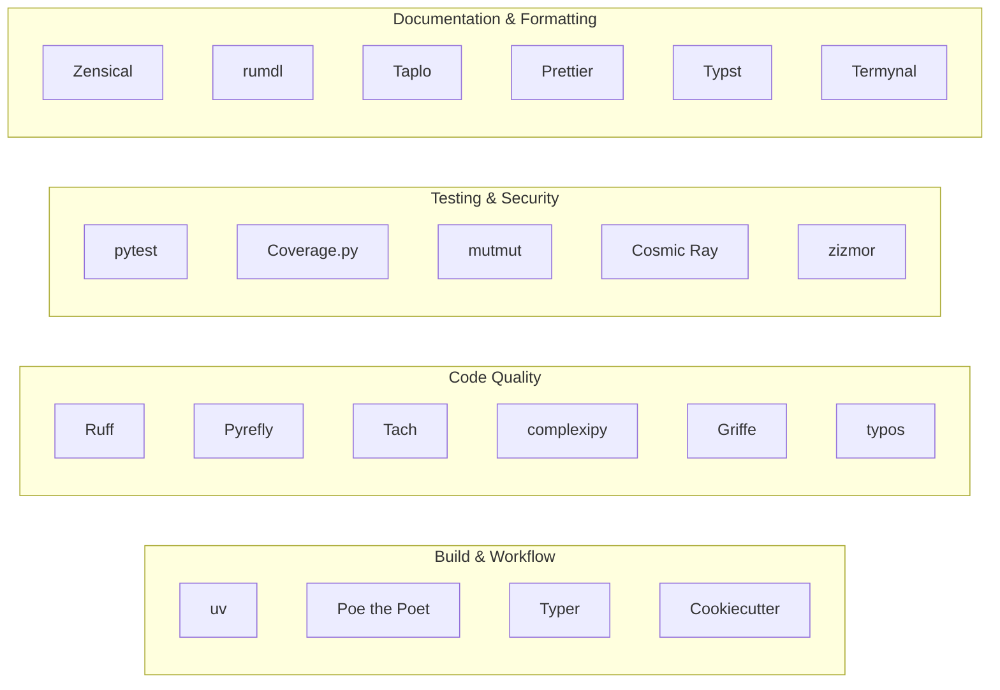

# Zenith Tooling Stack

Zenith replaces fragmented, slow Python tooling with an ultra-fast, Rust-powered toolchain configured with strict quality guardrails.

---

## Tooling Matrix

| Tool | Group | Primary Role | Upstream Documentation |
|---|---|---|---|
| **[uv](uv.md)** | Build & Workflow | Package manager, virtual environments, lockfiles, and PEP 517 builds | [docs.astral.sh/uv](https://docs.astral.sh/uv/) |
| **[Poe the Poet](poethepoet.md)** | Build & Workflow | Declarative development task runner integrated with uv | [poethepoet.natn.io](https://poethepoet.natn.io/) |
| **[Typer](typer.md)** | Build & Workflow | Type-safe CLI framework with Rich terminal rendering | [typer.tiangolo.com](https://typer.tiangolo.com/) |
| **[Cookiecutter](cookiecutter.md)** | Build & Workflow | Project templating engine powering Zenith generation | [cookiecutter.readthedocs.io](https://cookiecutter.readthedocs.io/) |
| **[Ruff](ruff.md)** | Code Quality | Blazing-fast Python linter and formatter with preview rules | [docs.astral.sh/ruff](https://docs.astral.sh/ruff/) |
| **[Pyrefly](pyrefly.md)** | Code Quality | Meta's strict type checker and 100% type coverage engine | [github.com/facebook/pyrefly](https://github.com/facebook/pyrefly) |
| **[Tach](tach.md)** | Code Quality | Modular boundary enforcement, circular dependency blocker | [github.com/gauge-sh/tach](https://github.com/gauge-sh/tach) |
| **[complexipy](complexipy.md)** | Code Quality | Fast cognitive complexity analyzer enforcing max <= 10 | [github.com/rohaquinlop/complexipy](https://github.com/rohaquinlop/complexipy) |
| **[Griffe](griffe.md)** | Code Quality | Static AST analysis and breaking public API change detector | [mkdocstrings.github.io/griffe](https://mkdocstrings.github.io/griffe/) |
| **[typos](typos.md)** | Code Quality | High-performance source code and doc spell checker | [github.com/crate-ci/typos](https://github.com/crate-ci/typos) |
| **[pytest](pytest.md)** | Testing & Security | Fixture-based test framework with parallel, property, and snapshot plugins | [docs.pytest.org](https://docs.pytest.org/) |
| **[Coverage.py](coverage.md)** | Testing & Security | 100% statement and branch test coverage engine | [coverage.readthedocs.io](https://coverage.readthedocs.io/) |
| **[mutmut](mutmut.md)** | Testing & Security | Fast AST mutation testing for local TDD loops (macOS/Linux) | [mutmut.readthedocs.io](https://mutmut.readthedocs.io/) |
| **[Cosmic Ray](cosmic-ray.md)** | Testing & Security | AST mutation testing evaluating test suite assertiveness | [cosmic-ray.readthedocs.io](https://cosmic-ray.readthedocs.io/) |
| **[zizmor](zizmor.md)** | Testing & Security | Static security analysis tool for GitHub Actions workflows | [woodruffw.github.io/zizmor](https://woodruffw.github.io/zizmor/) |
| **[Zensical](zensical.md)** | Documentation & Formatting | Fast TOML-based static documentation generator | [github.com/zensical/zensical](https://github.com/zensical/zensical) |
| **[rumdl](rumdl.md)** | Documentation & Formatting | Rust-native Markdown linter and embedded code checker | [github.com/rvben/rumdl](https://github.com/rvben/rumdl) |
| **[Taplo](taplo.md)** | Documentation & Formatting | Consistent TOML formatting and schema validation | [taplo.tamasfe.dev](https://taplo.tamasfe.dev/) |
| **[Prettier](prettier.md)** | Documentation & Formatting | Opinionated formatter for YAML workflows and CSS stylesheets | [prettier.io](https://prettier.io/) |
| **[Typst](typst.md)** | Documentation & Formatting | Markup-based layout engine for compiling SVG documentation assets | [typst.app/docs](https://typst.app/docs/) |
| **[Termynal](termynal.md)** | Documentation & Formatting | Lightweight terminal animation widget for documentation | [github.com/ines/termynal](https://github.com/ines/termynal) |

---

## Tool Categories

Click any tool above to explore its technical description, architectural rationale in Zenith, detailed configuration options, and upstream references.
