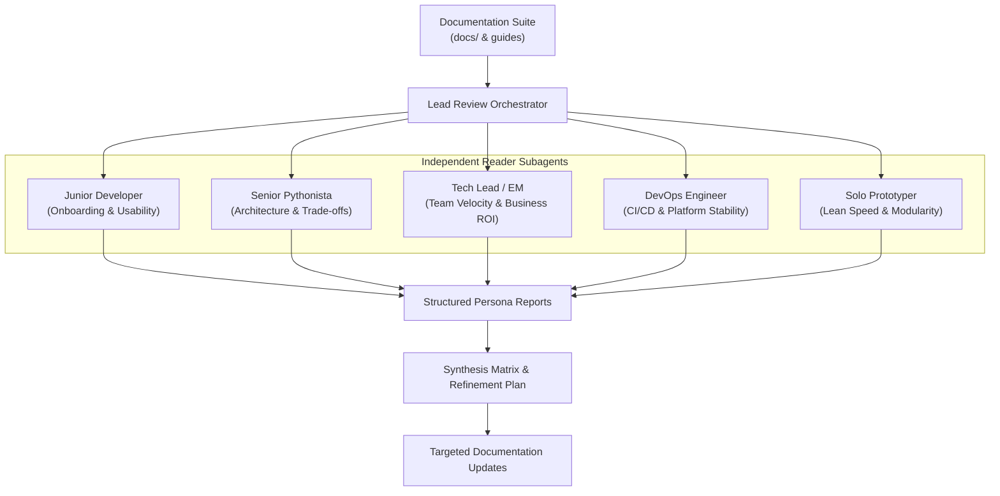

# Documentation Consumer Review Workflow (`workflow-docs-consumers`)

This skill defines the procedure to evaluate documentation through simulated developer personas.

Technical writers and code authors suffer from the curse of knowledge.
Authors understand architecture details and accidentally omit essential onboarding context.
This workflow dispatches independent reader agents with simulated backgrounds to audit documentation before release.

---

## 1. Multi-Persona Evaluation Model

Reviewing documentation through a single perspective creates blind spots.
Zenith evaluates documentation across complementary developer archetypes:



Consult [references/personas.md](./references/personas.md) for full descriptions of all persona archetypes.

---

## 2. End-to-End Execution Procedure

Follow these four steps to execute a documentation consumer audit:

### Step 1: Select Evaluation Personas
Select two to three complementary personas based on your review goals:
- For onboarding and usability: Pair **The Junior Developer** and **The Solo Prototyper**.
- For architectural rigor: Pair **The Senior Pythonista** and **The Tech Lead**.
- For platform and operations: Pair **The DevOps Engineer** and **The Tech Lead**.
- For an exhaustive audit: Dispatch all five personas before major releases.

### Step 2: Dispatch Independent Reader Subagents
Dispatch each persona as an independent subagent with clean context:
1. Provide the persona mandate using [templates/persona_prompt.md](./templates/persona_prompt.md).
2. Set read-only permissions for the subagent so it does not modify files during review.
3. Instruct the subagent to read the target documentation files.
4. Require the subagent to return findings using [templates/evaluation_report.md](./templates/evaluation_report.md).

### Step 3: Synthesize Multi-Persona Findings
When all subagents deliver reports, compile a cross-persona matrix:
1. **First Impressions**: Identify where the project pitch or elevator message was unclear.
2. **Unanswered Questions**: Extract questions that arose across multiple readers.
3. **Friction Points**: Document scary terminology, cognitive complexity, or tone dissonance.
4. **Architectural Gaps**: Record technical trade-offs that require clearer justification.

### Step 4: Implement Refinements and Verify
Apply targeted edits to the documentation:
1. **Clarify Onboarding**: Add explicit definitions and quick translation tables for beginners.
2. **Defend Trade-offs**: Add architectural justifications for senior reviewers.
3. **Calibrate Tone**: Ensure tone remains supportive, empowering, and free from empty marketing buzzwords.
4. **Run Verification Gates**:
   ```bash
   uv run poe format-md
   uv run poe lint-md
   uv run poe docs-build
   uv run poe code-quality
   ```

---

## 3. Templates and References

- [templates/persona_prompt.md](./templates/persona_prompt.md) — Subagent dispatch prompt template.
- [templates/evaluation_report.md](./templates/evaluation_report.md) — Structured report schema for persona findings.
- [references/personas.md](./references/personas.md) — Master catalog of five developer persona archetypes.
  - [references/junior-developer.md](./references/junior-developer.md) — Onboarding friction and beginner misconceptions.
  - [references/senior-pythonista.md](./references/senior-pythonista.md) — Architecture choices and tool trade-offs.
  - [references/tech-lead.md](./references/tech-lead.md) — Team velocity, maintenance cost, and business ROI.
  - [references/devops-engineer.md](./references/devops-engineer.md) — CI/CD performance and containerization.
  - [references/solo-prototyper.md](./references/solo-prototyper.md) — Development velocity, minimal ceremony, and modularity.
