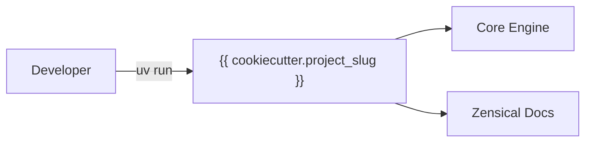

# {{ cookiecutter.project_name }}

<p align="center">
  
</p>

Welcome to the documentation for **{{ cookiecutter.project_name }}**.

{{ cookiecutter.description }}





## Quick Start CLI

<div class="termy">

```console
$ uv run {{ cookiecutter.project_slug }} greet "World"

✨ Hello, World!

// Inspect CLI options and help
$ uv run {{ cookiecutter.project_slug }} --help

<b>Usage: </b><b>{{ cookiecutter.project_slug }} [OPTIONS] COMMAND [ARGS]...</b>

╭─ Options ─────────────────────────────────────────╮
│ --version  -v        Show version and exit.       │
│ --help               Show this message and exit.  │
╰───────────────────────────────────────────────────╯
╭─ Commands ────────────────────────────────────────╮
│ greet                Display a personalized       │
│                      greeting.                    │
╰───────────────────────────────────────────────────╯
```

</div>



## Installation

=== "uv (Recommended)"

```bash
uv add {{ cookiecutter.project_slug }}
```

=== "pip"

```bash
pip install {{ cookiecutter.project_slug }}
```

> [!TIP]
> Always run project commands via `uv run poe <task>` or `uv run <command>`. This
> guarantees hermetic execution inside the managed virtual environment without manual
> activation.

## Highlights


## Architecture & Project Layout

```python exec="on"
from pathlib import Path

KEY_CONFIGS = ["pyproject.toml", "poe_tasks.toml", "zensical.toml"]
PRIMARY_DIRS = ["src", "tests", "docs"]

lines = ["./"]
lines.extend(f"  {f}" for f in KEY_CONFIGS if Path(f).exists())


def walk_dir(d: Path, indent: str) -> None:
    items = sorted(d.iterdir(), key=lambda p: (not p.is_dir(), p.name.lower()))
    for item in items:
        if item.name.startswith(
            (
                ".",
                "__pycache__",
                "__snapshots__",
                "assets",
                "javascripts",
                "stylesheets",
            )
        ):
            continue
        if item.name.endswith((".pyc", ".pyo")):
            continue
        if item.is_dir():
            lines.append(f"{indent}{item.name}/")
            walk_dir(item, indent + "  ")
        else:
            lines.append(f"{indent}{item.name}")


for d in PRIMARY_DIRS:
    dp = Path(d)
    if dp.is_dir():
        lines.append(f"  {d}/")
        walk_dir(dp, "    ")

print("```tree")
for line in lines:
    print(line)
print("```")
```

> [!NOTE]
> The directory tree above is rendered dynamically at documentation build time using
> the `markdown-exec` plugin with the ` ```tree ` fence.

## Mathematical Notation

LaTeX equations are fully supported via MathJax:

$$
f(x) = \int_{-\infty}^\infty \hat{f}(\xi)\,e^{2 \pi i \xi x}\,d\xi
$$

Inline equations such as $E = mc^2$ and $\mathcal{O}(n \log n)$ render smoothly.

## Dynamic Code Execution

Execute embedded Python and shell snippets at documentation build time:

```python exec="on"
import sys

print(f"Docs built with Python {sys.version.split()[0]} via markdown-exec!")
```

## Next Steps

- Follow the [Getting Started](getting-started.md) guide to set up your environment.
- Review the [API Reference](reference.md) for module details.
- Consult [Architecture Decision Records (ADRs)](adr/index.md) for key design choices.
- Review the [Changelog](changelog.md) for release history.

---

<p align="center">
  <sub>
    Built with the <a href="https://github.com/bwrob/zenith">Zenith</a> template
    by <a href="https://bwrob.dev">bwrob</a>.
  </sub>
</p>
